# Asistente de Lectura Fácil con IA

> **TFM · Máster en Desarrollo con IA (BigSchool)**
> Herramienta que ayuda a adaptar textos a **lectura fácil** según la norma **UNE 153101 EX**, con revisión automática de pautas, verificación de que no se pierde información y exportación maquetada.
> **La IA prepara el borrador; las personas lo validan.**

| | |
|---|---|
| **Autor** | David Martín Casas |
| **Plazo oficial** | 30/11/2026 |
| **Desarrollo** | 16/11/2026 – 27/11/2026 (tardes y fines de semana) |
| **Entrega prevista** | 29/11/2026 |
| **Estado** | Preparación |

---

## Índice

1. [Resumen](#1-resumen)
2. [El problema](#2-el-problema)
3. [Estado del arte](#3-estado-del-arte)
4. [Objetivos y alcance](#4-objetivos-y-alcance)
5. [Usuarios y caso de uso](#5-usuarios-y-caso-de-uso)
6. [Requisitos](#6-requisitos)
7. [Arquitectura](#7-arquitectura)
8. [Pipeline de adaptación](#8-pipeline-de-adaptación)
9. [Modelos de IA](#9-modelos-de-ia)
10. [Revisor de pautas](#10-revisor-de-pautas)
11. [Verificación del significado](#11-verificación-del-significado)
12. [Índices de legibilidad](#12-índices-de-legibilidad)
13. [Ciclo de vida de un documento](#13-ciclo-de-vida-de-un-documento)
14. [Modelo de datos](#14-modelo-de-datos)
15. [API](#15-api)
16. [Seguridad y privacidad](#16-seguridad-y-privacidad)
17. [Despliegue](#17-despliegue)
18. [Evaluación](#18-evaluación)
19. [Stack tecnológico](#19-stack-tecnológico)
20. [Estructura del repositorio](#20-estructura-del-repositorio)
21. [Plan de trabajo](#21-plan-de-trabajo)
22. [Entregables del TFM](#22-entregables-del-tfm)
23. [Riesgos](#23-riesgos)
24. [Módulos del máster que cubre](#24-módulos-del-máster-que-cubre)
25. [Evolución futura](#25-evolución-futura)
26. [Licencias](#26-licencias)
27. [Glosario](#27-glosario)
28. [Referencias](#28-referencias)

---

## 1. Resumen

La **lectura fácil** es una forma de escribir y maquetar textos para que los entiendan personas con dificultades de comprensión lectora: personas con discapacidad intelectual, personas mayores, personas que están aprendiendo castellano o con poca formación.

Adaptar un texto a mano lleva horas o días. Este proyecto propone una herramienta web que:

1. **Detecta** en el texto original lo que dificulta la lectura (siglas, porcentajes, voz pasiva, frases largas, plazos confusos…).
2. **Genera** una versión adaptada siguiendo las pautas de la norma UNE 153101 EX.
3. **Revisa** automáticamente que la adaptación cumple cada pauta.
4. **Verifica** con un segundo modelo de IA que no se ha perdido ni cambiado ningún dato importante (plazos, importes, requisitos).
5. **Mide** la mejora de legibilidad con índices validados para el castellano.
6. **Exporta** en el formato que elija el usuario: **DOCX, PDF, Markdown o texto**.

Es un proyecto **open source y autoalojable**: se publica en GitHub y cualquiera puede instalarlo en su infraestructura con los proveedores de IA que elija. Quien lo despliega es responsable de los datos que procesa. El despliegue del TFM es solo una instancia de ejemplo.
7. **Marca** el documento como *borrador pendiente de validación*, porque la norma exige validación por personas del grupo destinatario.

---

## 2. El problema

- Las administraciones y entidades tienen cada vez más obligaciones de accesibilidad, también cognitiva.
- La adaptación manual es **lenta y cara**, y depende de pocos profesionales especializados.
- Los documentos administrativos (convocatorias, cartas, bases de ayudas) son de los más difíciles de entender y de los más importantes para la vida de las personas.
- Las herramientas existentes son **pilotos o prototipos de investigación**, no herramientas abiertas listas para usar.

---

## 3. Estado del arte

| Proyecto | Tipo | Qué hace | Limitación |
|---|---|---|---|
| **ATECA** (Universidad de Salamanca / INICO) | Prototipo de investigación | Analiza textos según la UNE 153101 y sugiere cambios | La primera fase cubre solo algunas pautas (conectores, mayúsculas, superlativos) |
| **ALF-INICO** (2022) | Prototipo | Calcula indicadores léxicos, sintácticos y semánticos para ayudar al profesional | Sus autores consideran la automatización completa *"una quimera"* |
| **Piloto del Gobierno de Aragón** | Piloto de administración pública | Borradores de páginas web en lectura fácil con IA, validados con apoyo de Plena Inclusión | Piloto; publicó prompts y arquitectura |
| **Universidad de La Rioja + Plena Inclusión La Rioja** | Convenio de I+D | Herramientas de procesamiento de lenguaje natural para lectura fácil | En desarrollo |

**Hueco que cubre este proyecto:** una herramienta **abierta, usable y de principio a fin** (adaptar → revisar pautas → verificar el significado → maquetar → validar), con evaluación medible y que puede funcionar solo con modelos locales en infraestructura propia.

---

## 4. Objetivos y alcance

### Objetivo general
Reducir el tiempo de preparación de un borrador en lectura fácil de horas a minutos, **sin perder información** y **sin sustituir** la validación humana.

### Objetivos específicos
- O1. Adaptación automática basada en las pautas de la UNE 153101 EX.
- O2. Revisor automático de pautas, con marcado de incumplimientos.
- O3. Verificación independiente de que se conservan los datos clave.
- O4. Medición de legibilidad antes y después.
- O5. Exportación en DOCX, PDF, Markdown o texto, con la maquetación de la norma en DOCX y PDF.
- O6. Privacidad por configuración: si quien despliega configura solo un proveedor local, ningún documento sale de su infraestructura.
- O7. Evaluación cuantitativa frente a textos adaptados por profesionales.

### Alcance

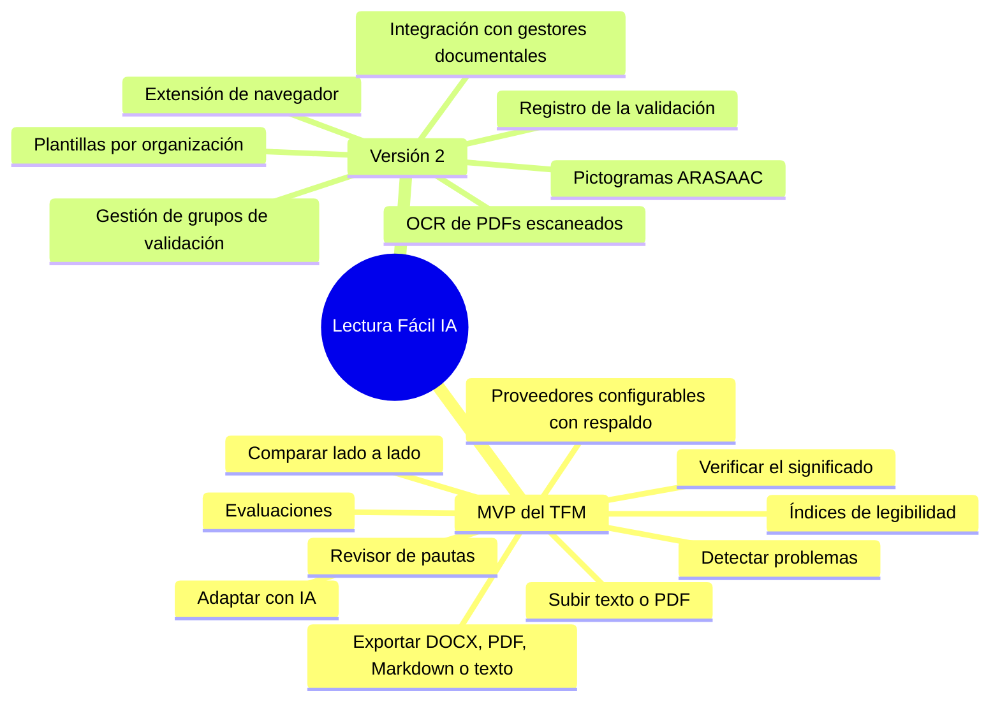

---

## 5. Usuarios y caso de uso

### Personas usuarias

| Persona | Necesidad |
|---|---|
| **Técnica de una administración** (por ejemplo, Lucía, área de Vivienda) | Publicar convocatorias y avisos también en lectura fácil |
| **Profesional de adaptación** de una entidad social | Acelerar la primera fase y centrarse en revisar y validar |
| **Persona validadora** | Leer el borrador y opinar si se entiende |
| **Ciudadanía** | Recibir información que pueda entender |

### Caso de uso principal

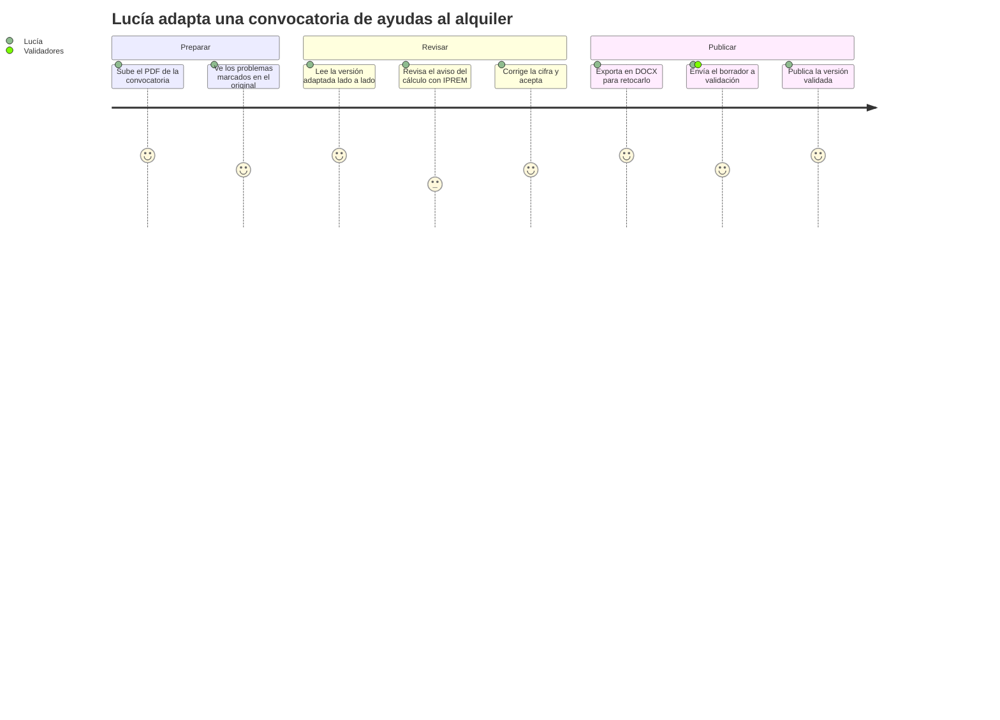

### Ejemplo antes y después

**Original:**
> La Concejalía de Vivienda, en virtud de lo dispuesto en la Ordenanza Municipal 7/2024, convoca ayudas destinadas a sufragar parcialmente el coste del arrendamiento de vivienda habitual. Podrán ser beneficiarias aquellas personas físicas cuyos ingresos no excedan de 2,5 veces el IPREM, siempre que no sean titulares de otra vivienda. La cuantía de la ayuda ascenderá al 40 % de la renta mensual, con un máximo de 250 €. Las solicitudes deberán presentarse, junto con la documentación acreditativa, en el plazo de quince días hábiles a contar desde el día siguiente a la publicación del presente extracto en el BOP.

**Lectura fácil (borrador generado):**

> **Ayudas para pagar el alquiler**
>
> El Ayuntamiento da ayudas
> para pagar el alquiler de su casa.
>
> **¿Quién puede pedir la ayuda?**
>
> Puede pedir la ayuda si:
> - Vive de alquiler en la ciudad.
> - No tiene otra casa a su nombre.
> - Gana menos de 1.500 euros al mes. ⚠️ *(cálculo a revisar)*
>
> **¿Cuánto dinero da la ayuda?**
>
> El Ayuntamiento paga una parte de su alquiler.
> Como mucho, 250 euros al mes.
> Por ejemplo: si paga 500 euros de alquiler,
> la ayuda es de 200 euros.
>
> **¿Cómo pido la ayuda?**
>
> Rellene la **solicitud**.
> Lleve los papeles que demuestran lo que gana.
> Tiene 15 días para pedirla.
> No cuentan sábados, domingos ni festivos.
> Los 15 días empiezan el día después
> de que salga el anuncio en el **Boletín Oficial**.

**Glosario:** *Solicitud*: papel que se rellena para pedir algo. *Boletín Oficial*: periódico donde el Gobierno publica sus anuncios.

> Los datos de este ejemplo son inventados.

---

## 6. Requisitos

### Funcionales

| ID | Requisito | Prioridad |
|---|---|---|
| RF-01 | Subir un texto pegado o un PDF digital (PDF escaneado con OCR: versión 2) | Must |
| RF-02 | Detectar y marcar los problemas del texto original con la pauta que incumplen | Must |
| RF-03 | Generar la versión adaptada con títulos en forma de pregunta, frases cortas y glosario | Must |
| RF-04 | Revisar la versión adaptada contra cada pauta | Must |
| RF-05 | Verificar que se conservan los datos clave y avisar de cambios u omisiones | Must |
| RF-06 | Calcular los índices de legibilidad del original y de la adaptación | Must |
| RF-07 | Mostrar original y adaptación lado a lado, con edición manual | Must |
| RF-08 | Exportar en el formato elegido: DOCX, PDF, Markdown o texto (maquetación de la norma en DOCX y PDF) | Must |
| RF-09 | Etiquetar cada documento como *borrador pendiente de validación* | Must |
| RF-10 | Proveedor principal y de respaldo opcional, elegidos por configuración (local, Azure o ambos) | Must |
| RF-11 | Lista simple de documentos del usuario | Should |
| RF-12 | Registrar el resultado de la validación humana | Could (adelantado al MVP: US-21 y US-22) |
| RF-13 | Pictogramas de apoyo (ARASAAC) | Could (v2) |

### No funcionales

| ID | Requisito |
|---|---|
| RNF-01 | **Privacidad:** con solo el proveedor local configurado, ningún contenido sale de la infraestructura propia |
| RNF-02 | **Fiabilidad:** ningún dato clave puede cambiar sin generar un aviso |
| RNF-03 | **Rendimiento:** borrador de un documento de 2–3 páginas en menos de 60 s |
| RNF-04 | **Accesibilidad:** la propia web cumple WCAG 2.2 AA |
| RNF-05 | **Seguridad:** OWASP Top 10 y OWASP LLM Top 10 (inyección en documentos) |
| RNF-06 | **Portabilidad:** el proveedor de modelos se cambia por configuración |
| RNF-07 | **Observabilidad:** trazas por petición (modelo, tokens, tiempo, avisos) |
| RNF-08 | **Coste:** menos de 10 € al mes durante la evaluación (VPS + Azure solo como respaldo) |
| RNF-09 | **Disponibilidad:** con respaldo configurado, la aplicación sigue funcionando aunque el servidor IA esté caído |

---

## 7. Arquitectura

### Contexto (C4 nivel 1)

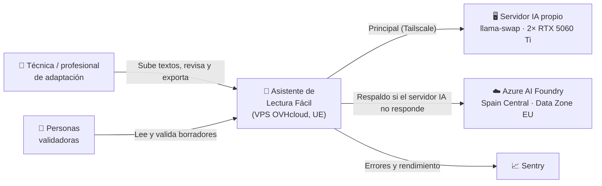

### Contenedores (C4 nivel 2)

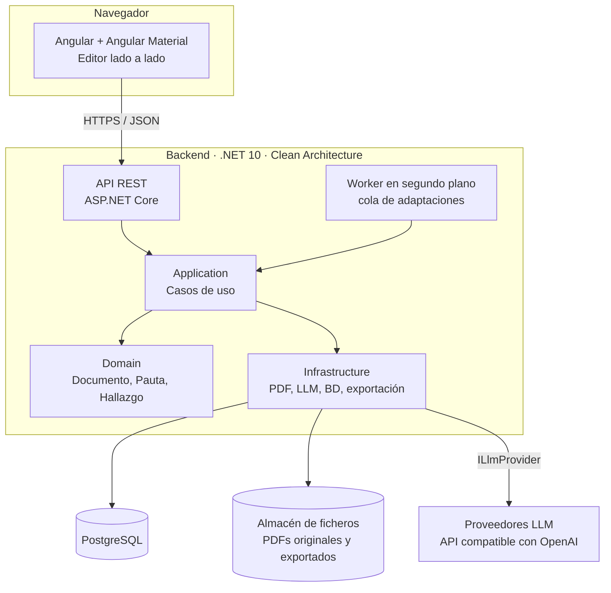

### Capas (Clean Architecture)

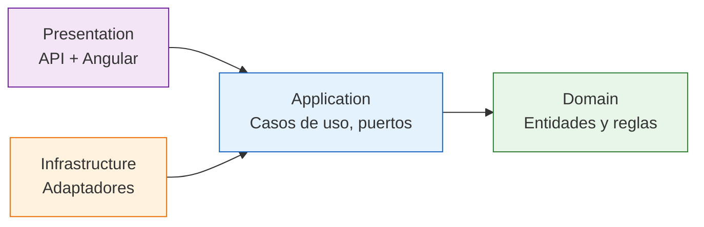

**Puertos principales (interfaces en Application):**

| Puerto | Implementaciones |
|---|---|
| `ILlmProvider` | `OpenAICompatibleProvider` (Ollama, LM Studio, vLLM, llama-swap…) y `AzureFoundryProvider`; cualquiera puede ser principal o respaldo según la configuración. Envueltos en `ResilientLlmProvider` (circuit breaker con Polly) |
| `ITextExtractor` | `PdfPigExtractor` (PDF digital), `OcrExtractor` (Qwen3-VL para escaneados) |
| `IGuidelineChecker` | Reglas deterministas por pauta |
| `IMeaningVerifier` | Verificador con un LLM de otra familia |
| `IReadabilityCalculator` | Fernández Huerta, Szigriszt-Pazos / INFLESZ |
| `IDocumentExporter` | `DocxExporter` (Open XML SDK), `PdfExporter` (PDFsharp + MigraDoc), `MarkdownExporter`, `PlainTextExporter` (patrón estrategia) |

---

## 8. Pipeline de adaptación

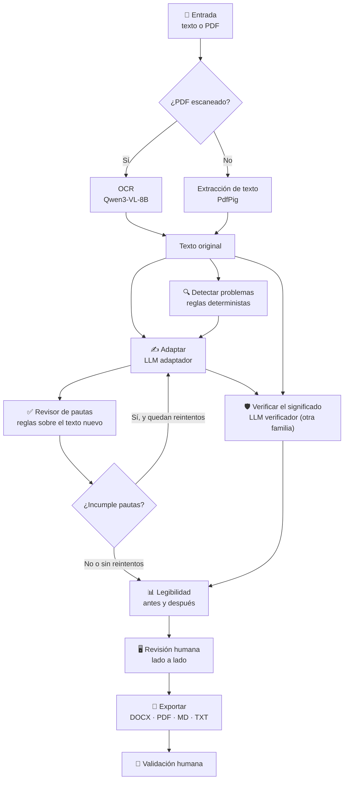

### Secuencia de una adaptación

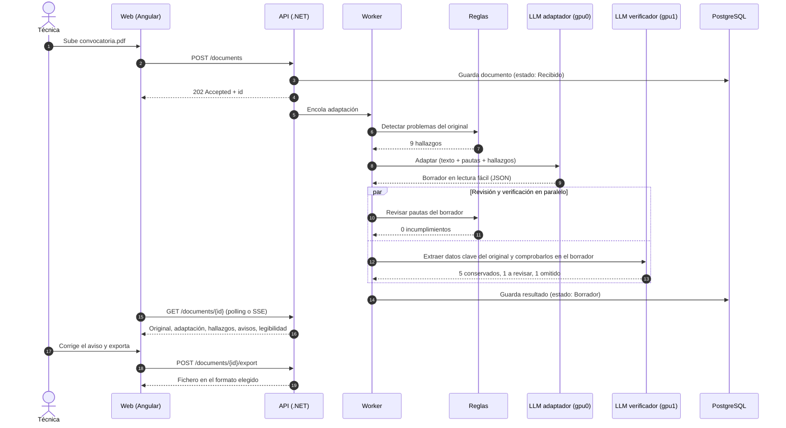

---

## 9. Modelos de IA

### Asignación por paso (servidor propio)

| Paso | Modelo | GPU | Motivo |
|---|---|---|---|
| **Adaptar** | Gemma-4-26B-A4B | gpu0 | Buena redacción en castellano, ~30 tok/s, 131k de contexto |
| **Verificar** | Qwen3.5-9B (alias `extraer`) | gpu1 | Extracción estructurada; **otra familia** que el adaptador |
| **OCR** | Qwen3-VL-8B (alias `ocr`) | gpu1 | Solo para PDFs escaneados |
| **Juez en evaluaciones** | GPT-OSS-20B (alias `revisor`) | gpu0 | Solo en las ejecuciones de evaluación |
| **Similitud** | BGE-M3 (alias `embed`) | servicios | Métrica de evaluación frente a la adaptación profesional |
| Pictogramas (v2) | Granite-4.2-8B | gpu1 | Elección de palabras clave |

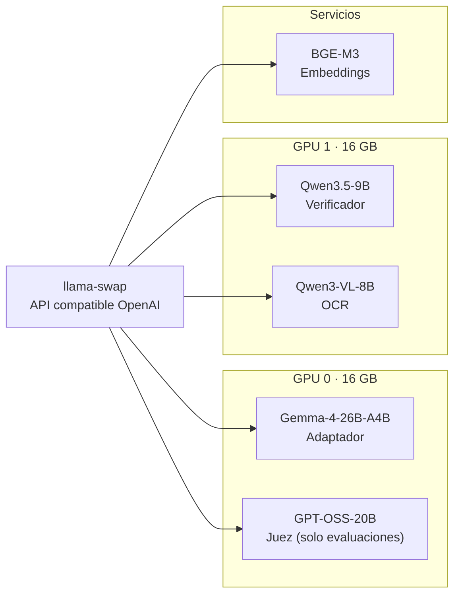

**Por qué una GPU para cada papel:** adaptador y verificador están cargados a la vez, sin intercambios de modelo, y se puede verificar un documento mientras se adapta el siguiente.

### Candidatos que compiten en la evaluación

| Candidato | Por qué |
|---|---|
| Gemma-4-26B-A4B | Candidato principal |
| Qwen3.6-35B-A3B | El más rápido de los grandes (~59 tok/s) |
| Salamandra-7B (BSC) | Modelo público español; argumento fuerte para administraciones. Contexto de 16k (adaptar por secciones) |
| mistral-nemo 12B | Referencia: buena redacción técnica en castellano |
| gpt-4.1-mini (Azure) | El modelo de respaldo; hay que saber cómo se compara |

> Con el plazo ajustado, la evaluación del MVP usa **3 modelos**: Gemma-4-26B-A4B, uno de los locales rápidos (Qwen3.6-35B-A3B o Salamandra-7B) y gpt-4.1-mini.

### Asignación por paso (Azure, respaldo)

Recurso de **Azure AI Foundry en Spain Central**, despliegues de tipo **Data Zone Standard (EU)**: los datos se procesan dentro de la UE y Azure no los usa para entrenar.

| Paso | Despliegue | Motivo |
|---|---|---|
| **Adaptar** | `gpt-4.1-mini` | No razona (rápido y barato), sigue bien las instrucciones, admite salida estructurada. ~0,44 $ / 1,76 $ por millón de tokens en Data Zone |
| **Verificar** | `mistral-medium-3-5` (alternativa: `DeepSeek-V4-Flash`) | **Otra familia** que el adaptador, también en Data Zone EU |

### Configuración de proveedores

La aplicación **se usa siempre igual**. Quien la despliega elige por configuración un proveedor **principal** y, opcionalmente, uno de **respaldo** que solo entra si el principal falla. Así, la privacidad depende de **dónde y cómo se instala**, no de opciones del usuario.

| Configuración | Principal | Respaldo | Privacidad |
|---|---|---|---|
| **Solo local** (por ejemplo, una administración en su propia infraestructura) | Servidor IA propio | Deshabilitado | Ningún documento sale de la infraestructura. Si el servidor cae, los documentos esperan en cola |
| **Local + Azure** (despliegue del TFM) | Servidor IA propio (por Tailscale) | Azure, Data Zone EU | Normalmente local; si el servidor cae, se procesa en Azure dentro de la UE |
| **Solo Azure** | Azure, Data Zone EU | — | Todo se procesa en Azure dentro de la UE |

**Valores por defecto seguros:** sin configurar nada, el respaldo y Turnstile están **deshabilitados**, de modo que ningún documento va a un proveedor que no se haya configurado expresamente. El tipo de proveedor puede ser **`OpenAICompatible`** (Ollama, LM Studio, vLLM, llama-swap…) o **`AzureFoundry`**.

La interfaz indica siempre quién ha procesado cada documento: *"Servidor propio"* o *"Azure (UE)"*.

---

## 10. Revisor de pautas

Pautas comprobadas de forma **determinista** (sin IA), inspiradas en la UNE 153101 EX:

| Pauta | Cómo se detecta |
|---|---|
| Frases cortas | Nº de palabras por frase > umbral configurable (por ejemplo, 15) |
| Una idea por frase | Nº de verbos conjugados y conectores coordinantes por frase |
| Sin siglas sin explicar | Palabras en mayúsculas de 2–6 letras no presentes en el glosario |
| Sin porcentajes | Patrón `número + %` o "por ciento" |
| Números en cifras | Números escritos con letras ("quince") |
| Sin voz pasiva | Patrones "ser/estar + participio" y pasiva refleja con "se" |
| Sin negaciones dobles | "no … nunca", "no … nada", "no … ningún" |
| Sin números romanos | Patrón de números romanos |
| Palabras difíciles explicadas | Palabras fuera de una lista de vocabulario frecuente y no presentes en el glosario |
| Sin expresiones jurídicas complejas | Lista de expresiones ("en virtud de", "a tenor de", "sin perjuicio de"…) |
| Fechas completas | Formatos `dd/mm/aaaa` (se prefieren "15 de diciembre de 2026") |
| Títulos claros | Presencia de encabezados por sección |

Cada hallazgo guarda: **pauta**, **fragmento**, **posición**, **gravedad** y **sugerencia**.

---

## 11. Verificación del significado

Es la red de seguridad del sistema: **ningún dato clave puede cambiar sin generar un aviso**.

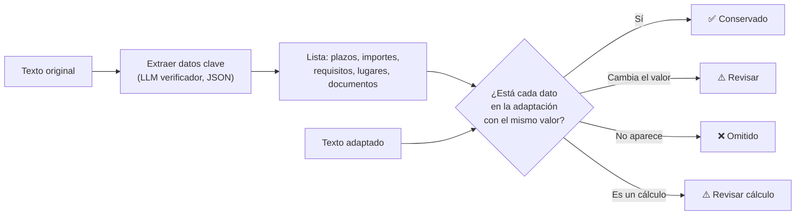

**Salida estructurada del verificador (ejemplo):**

```json
{
  "datos_clave": [
    { "tipo": "importe", "original": "máximo de 250 €", "adaptado": "Como mucho, 250 euros al mes", "estado": "conservado" },
    { "tipo": "plazo", "original": "quince días hábiles", "adaptado": "15 días… No cuentan sábados, domingos ni festivos", "estado": "conservado" },
    { "tipo": "requisito", "original": "ingresos no excedan de 2,5 veces el IPREM", "adaptado": "Gana menos de 1.500 euros al mes", "estado": "revisar", "motivo": "Conversión calculada; debe confirmarla una persona" },
    { "tipo": "referencia", "original": "Ordenanza Municipal 7/2024", "adaptado": null, "estado": "omitido", "motivo": "No necesaria para entender el texto" }
  ]
}
```

**Reglas de diseño:**
- El verificador es de **otra familia** de modelos que el adaptador.
- Los números se comprueban también con código (normalizando "quince" → 15, "250 €" → 250 euros).
- El verificador **solo puede añadir avisos**, nunca quitar los que detecta el código.

---

## 12. Índices de legibilidad

| Índice | Fórmula |
|---|---|
| **Fernández Huerta** | `L = 206,84 − 0,60·P − 1,02·F` (P = sílabas por cada 100 palabras; F = frases por cada 100 palabras) |
| **Szigriszt-Pazos** | `IFSZ = 206,835 − 62,3·(sílabas / palabras) − (palabras / frases)` |

**Escala INFLESZ** (sobre Szigriszt-Pazos):

| Puntuación | Grado |
|---|---|
| < 40 | Muy difícil |
| 40 – 55 | Algo difícil |
| 55 – 65 | Normal |
| 65 – 80 | Bastante fácil |
| > 80 | Muy fácil |

> Requiere un contador de sílabas para el castellano (se implementa con reglas de silabeo y tests).

---

## 13. Ciclo de vida de un documento

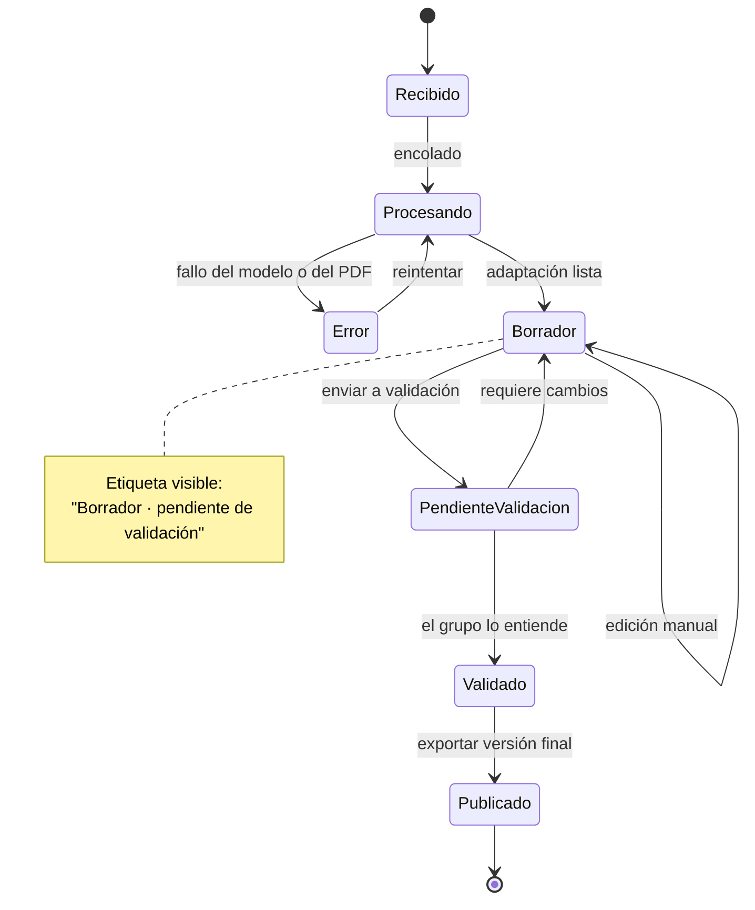

---

## 14. Modelo de datos

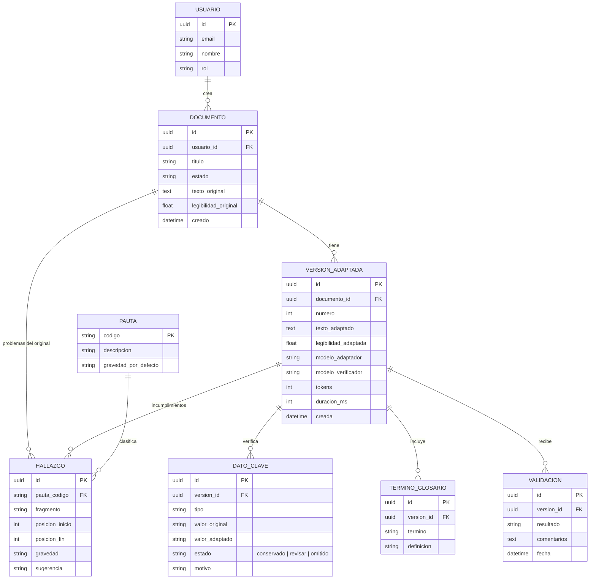

---

## 15. API

| Método | Ruta | Descripción |
|---|---|---|
| `POST` | `/api/documents` | Sube texto o PDF y encola la adaptación |
| `GET` | `/api/documents` | Lista los documentos del usuario |
| `GET` | `/api/documents/{id}` | Original, adaptación, hallazgos, datos clave y legibilidad |
| `GET` | `/api/documents/{id}/events` | Progreso en tiempo real (SSE) |
| `PUT` | `/api/documents/{id}/versions/{n}` | Guarda la edición manual |
| `POST` | `/api/documents/{id}/reprocess` | Vuelve a adaptar (otro modelo u otras opciones) |
| `POST` | `/api/documents/{id}/export?format=docx\|pdf\|md\|txt` | Genera el fichero en el formato elegido |
| `POST` | `/api/documents/{id}/validation/send` | Envía el borrador revisado a validación |
| `POST` | `/api/documents/{id}/validation` | Registra el resultado de la validación de la versión que leyó el grupo: personas y partes difíciles (409 si ya no es la pendiente) |
| `POST` | `/api/documents/{id}/validation/withdraw` | Retira el documento de la validación (vuelve a borrador) |
| `POST` | `/api/documents/{id}/publish` | Publica la versión validada |
| `GET` | `/api/samples` | Textos de ejemplo |
| `GET` | `/api/status/llm` | Disponibilidad del proveedor principal y del respaldo |
| `GET` | `/api/guidelines` | Pautas configuradas |

Contrato documentado con **OpenAPI** (Swagger) y generado desde el código.

---

## 16. Seguridad y privacidad

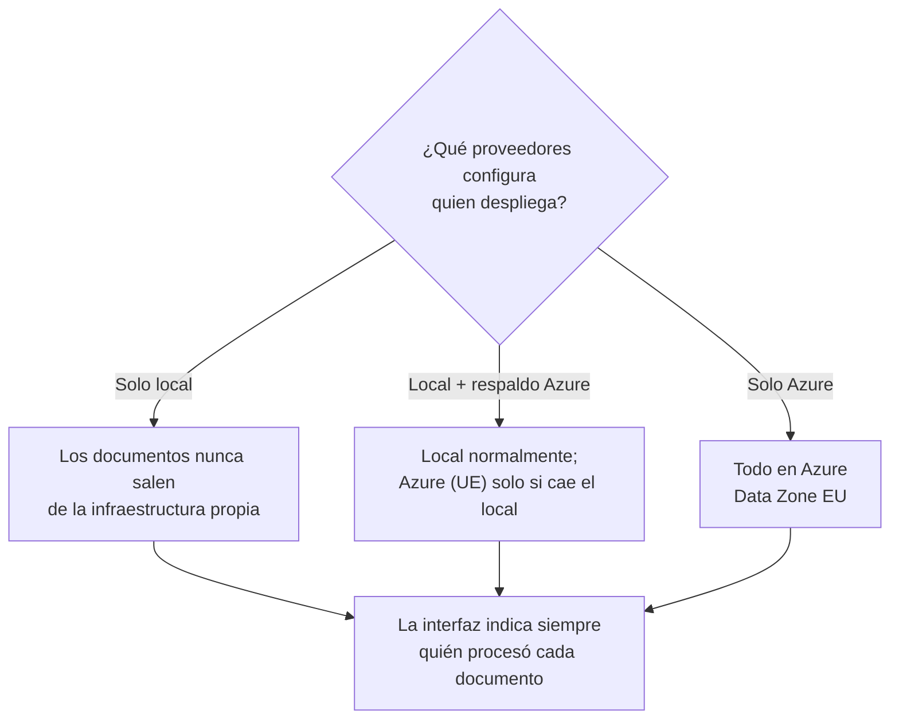

| Riesgo | Medida |
|---|---|
| **Datos personales** en documentos | La configuración de proveedores decide dónde se procesan (solo local si se quiere que nada salga); Azure siempre en Data Zone EU; la interfaz muestra quién procesó cada documento |
| **Inyección de prompt dentro del documento** (OWASP LLM01) | El documento va entre delimitadores y se trata como datos; el LLM no tiene herramientas ni acceso a nada más; la salida se valida con un esquema JSON |
| **Salida insegura** (OWASP LLM05) | El texto generado se muestra escapado, nunca como HTML |
| **Consumo sin límites** (OWASP LLM10) | Límite de tamaño del documento, de tokens y de peticiones |
| **Alucinaciones que cambian datos** | Verificador independiente + comprobación numérica por código |
| **Secretos** | Variables de entorno y GitHub Secrets; `.env.example`; gitleaks en CI |
| **Autenticación** | Login con usuario de prueba para el tribunal; roles (técnica, validador) |
| **API** | OWASP API Top 10: autorización por objeto, validación de entrada, límites |
| **VPS comprometido** | Se diseña asumiendo que puede pasar: ACLs de Tailscale que solo le permiten llegar al puerto de llama-swap; nada más del homelab |
| **llama-swap expuesto** | API key, proxy que solo deja pasar `/v1/chat/completions` y `/v1/models`, escucha solo en la interfaz de Tailscale |
| **Bots y abuso** | Cloudflare Turnstile al procesar, límites en Cloudflare y en la API |
| **Gasto inesperado en Azure** | Alerta de presupuesto en Cost Management; Azure solo como respaldo |
| **Uso por terceros (open source)** | Licencia Apache 2.0 "tal cual"; el README explica las configuraciones y que quien despliega es responsable de los datos; aviso configurable en la interfaz; `SECURITY.md` para reportar vulnerabilidades |
| **Enlaces o imágenes maliciosos en las exportaciones** (OWASP LLM05) | Escapado por formato; en Markdown se neutralizan enlaces, imágenes y HTML |
| **Dependencias con licencias restrictivas** | Solo licencias permisivas (MIT, Apache 2.0, BSD); QuestPDF, MediatR, AutoMapper, FluentAssertions v8 y PrimeNG v22+ descartados |

---

## 17. Despliegue

### Opciones de despliegue

Al ser un proyecto open source, cada organización lo despliega como quiera. El repositorio documenta dos opciones:

| Opción | Para quién | Qué necesita |
|---|---|---|
| **Mínima** | Cualquiera que quiera probarlo o usarlo internamente | Un servidor con Docker y un proveedor compatible con OpenAI (por ejemplo, Ollama) |
| **Referencia (instancia del TFM)** | Ejemplo de despliegue público con alta disponibilidad | La descrita a continuación |

### Despliegue de referencia (instancia del TFM)

La web vive en un **VPS de OVHcloud** (empresa europea). Los modelos **principales** están en el **servidor IA propio**, al que el VPS llega por **Tailscale**. **Azure AI Foundry** (Spain Central, Data Zone EU) actúa como **respaldo** si el servidor IA no responde.

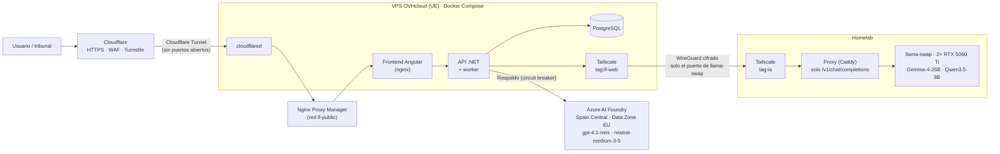

### Elección del proveedor en cada petición

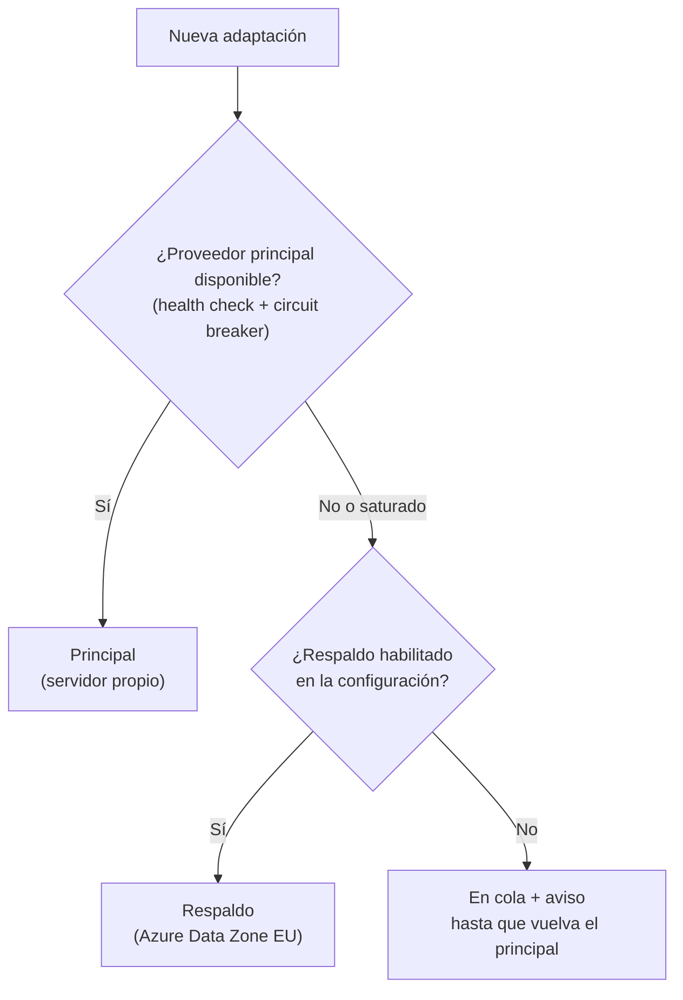

### Componentes

| Componente | Dónde | Notas |
|---|---|---|
| Frontend Angular, API .NET, PostgreSQL | VPS OVHcloud (2–4 vCPU, 4 GB RAM) | Docker Compose |
| Entrada web | Cloudflare Tunnel (`cloudflared` en el VPS) y Nginx Proxy Manager | Ningún puerto abierto a internet; HTTPS y WAF de Cloudflare. El proxy llega a la web por una red propia (`lf-public`); guía en `docs/despliegue.md` |
| Administración del VPS | SSH **solo por Tailscale** | Firewall del VPS bloqueando toda entrada |
| Enlace VPS ↔ servidor IA | Tailscale | ACLs: `tag:lf-web` solo llega a `tag:ia:<puerto de llama-swap>` |
| Modelos principales | Servidor IA propio (llama-swap) | API key + proxy que solo expone las rutas de inferencia |
| Modelos de respaldo | Azure AI Foundry, Spain Central, Data Zone EU | Alerta de presupuesto en Cost Management |
| Página de emergencia (opcional) | Cloudflare Pages | Ejemplos precalculados si el VPS cae |
| Monitorización | Sentry + métricas del VPS hacia VictoriaMetrics/Grafana por Tailscale | Alertas a ntfy si cae la web, llama-swap o se dispara el gasto de Azure |

### Requisitos previos de red (Tailscale)

- Política de acceso **sin la regla `* → *`**, con etiquetas (`tag:router`, `tag:ia`, `tag:lf-web`) y la sección `tests`.
- **Solo dispositivos propios en el tailnet** (ningún equipo de terceros).
- VPS añadido con una **clave de un solo uso** y la etiqueta `tag:lf-web`; sin aceptar rutas ni usar exit node.
- Comprobación desde el VPS: llama-swap responde; cualquier otra IP o puerto del homelab **falla**.

### Durante la evaluación

- Desactivar la **suspensión nocturna** del servidor IA desde la entrega hasta la nota (el respaldo de Azure cubre cualquier caída, pero el protagonista debe ser el servidor propio).
- Alertas activas en ntfy.

### Coste orientativo

| Concepto | Coste |
|---|---|
| VPS OVHcloud | Unos pocos € al mes (comprobar tarifa actual) |
| Azure (solo respaldo) | Céntimos |
| Tailscale, Cloudflare | 0 € (planes gratuitos) |
| **Total** | **< 10 € al mes** mientras dure la evaluación |

### Pipeline de CI/CD

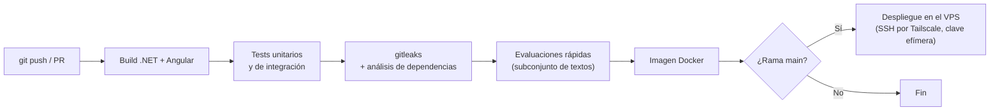

---

## 18. Evaluación

### Conjunto de datos
- **10 textos** (ampliable a 20 si hay tiempo) con su adaptación hecha por profesionales (documentos públicos en lectura fácil de administraciones y entidades).
- **5 textos trampa** con datos sensibles a cambios (plazos, importes, cálculos) para medir la verificación.

### Métricas

| Métrica | Cómo se mide |
|---|---|
| **% de pautas cumplidas** | Revisor determinista sobre la adaptación |
| **Mejora de legibilidad** | INFLESZ adaptado − INFLESZ original |
| **% de datos clave conservados** | Verificador + revisión manual de una muestra |
| **Recall del verificador** | En los textos trampa: avisos detectados / cambios introducidos |
| **Similitud con la adaptación profesional** | Similitud coseno con BGE-M3 |
| **Valoración del juez** | GPT-OSS-20B con una rúbrica (claridad, fidelidad, tono) |
| **Tiempo y coste por documento** | Trazas del sistema |

### Tabla de resultados (plantilla)

| Modelo adaptador | Pautas | Δ INFLESZ | Datos conservados | Similitud | Juez | tok/s |
|---|---|---|---|---|---|---|
| Gemma-4-26B-A4B | | | | | | |
| Qwen3.6-35B-A3B | | | | | | |
| Salamandra-7B | | | | | | |
| mistral-nemo 12B | | | | | | |
| gpt-4.1-mini (Azure, respaldo) | | | | | | |

> Criterio eliminatorio: un modelo que **cambie o pierda un dato clave sin aviso** queda descartado aunque puntúe bien en lo demás.

---

## 19. Stack tecnológico

| Capa | Tecnología |
|---|---|
| Frontend | Angular + Angular Material |
| Backend | .NET 10 (LTS; el soporte de .NET 8 termina en noviembre de 2026), ASP.NET Core, Clean Architecture |
| Cola y procesos en segundo plano | `BackgroundService` + `Channel<T>` (o Hangfire) |
| Base de datos | PostgreSQL + Entity Framework Core |
| Extracción de PDF | PdfPig |
| OCR | Qwen3-VL-8B vía llama-swap |
| LLM | API compatible con OpenAI: llama-swap (principal) y Azure AI Foundry (respaldo) |
| Resiliencia | Polly (circuit breaker, reintentos y tiempo máximo) + health check del servidor IA |
| Hosting | VPS OVHcloud con Docker Compose |
| Red privada | Tailscale con ACLs por etiquetas |
| Entrada web | Cloudflare Tunnel + Turnstile |
| Exportación | DOCX: Open XML SDK (MIT) · PDF: PDFsharp + MigraDoc (MIT) · Markdown y texto: sin librerías |
| Tests | xUnit, Shouldly o AwesomeAssertions (FluentAssertions v8 tiene licencia comercial), NSubstitute, Testcontainers, Playwright |
| Backlog para agentes | `Backlog-US/` (AGENTS.md, Definition of Done y 20 historias) |
| Evaluaciones | Proyecto de consola .NET con informes en Markdown/CSV |
| Observabilidad | Serilog + Sentry (+ métricas en Grafana del homelab) |
| Contenedores | Docker + Docker Compose |
| CI/CD | GitHub Actions |
| Documentación API | OpenAPI / Swagger |

---

## 20. Estructura del repositorio

```text
lectura-facil-ia/
├── README.md
├── docs/
│   ├── arquitectura.md
│   ├── adr/
│   │   ├── 0001-clean-architecture.md
│   │   ├── 0002-verificador-de-otra-familia.md
│   │   └── 0003-proveedores-configurables.md
│   ├── slides/
│   └── evaluacion/
├── src/
│   ├── LecturaFacil.Domain/
│   ├── LecturaFacil.Application/
│   ├── LecturaFacil.Infrastructure/
│   │   ├── Llm/
│   │   ├── Pdf/
│   │   ├── Readability/
│   │   ├── Guidelines/
│   │   └── Export/
│   ├── LecturaFacil.Api/
│   └── LecturaFacil.Web/          # Angular
├── evals/
│   ├── datasets/
│   ├── LecturaFacil.Evals/
│   └── resultados/
├── tests/
│   ├── LecturaFacil.Domain.Tests/
│   ├── LecturaFacil.Application.Tests/
│   ├── LecturaFacil.Infrastructure.Tests/
│   └── LecturaFacil.E2E/
├── deploy/
│   ├── docker-compose.yml
│   ├── docker-compose.prod.yml
│   └── .env.example
└── .github/workflows/
    ├── ci.yml
    └── deploy.yml
```

---

## 21. Plan de trabajo

> **Disponibilidad:** tardes entre semana (≈ 18:30–22:30) y fines de semana completos. Unas **60 horas** en total.
> **Desarrollo:** del lunes 16 al viernes 27. **Cierre de funcionalidades:** viernes 27. **Entrega:** domingo 29. **Plazo oficial:** lunes 30 (colchón).

### Cómo se trabaja: agentes en la nube durante el día

El código lo escriben los agentes; el tiempo del autor se dedica a **revisar, probar y decidir**.

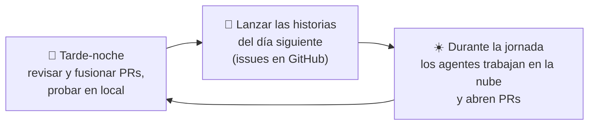

- **Cada historia es una *issue* de GitHub** con el contenido de su fichero del backlog.
- **Agentes en la nube** (por ejemplo, tareas en la nube de Codex, el agente de Copilot asignado a una *issue* o Claude Code en la web). Como nadie puede aprobar su plan a mediodía, **el agente pone el plan en la descripción de la PR** y el autor lo revisa por la tarde junto con el código.
- **Los agentes en la nube no reciben secretos:** los tests usan `FakeLlmProvider`.
- **Lo que requiere al autor** (infraestructura, despliegue, ejecutar las evaluaciones con los modelos reales, slides y vídeo) va a las tardes y a los fines de semana.
- Todo desde dispositivos y cuentas **personales**.

### Recortes por plazo

Con tardes y fines de semana, el alcance se ajusta así. Lo recortado pasa a la versión 2 (sección 25).

| Se queda en el MVP | Se recorta |
|---|---|
| Texto pegado y PDF digital | OCR de PDFs escaneados |
| Adaptador, revisor de pautas y verificador del significado | Reintentos automáticos de adaptación (como mucho 1) |
| Índice INFLESZ (Szigriszt-Pazos) | Fernández Huerta, si no da tiempo |
| Interfaz lado a lado con edición | Historial completo (solo lista simple de documentos) |
| Exportación en DOCX, Markdown y texto | Exportación a PDF, si no da tiempo (se puede generar desde el DOCX) |
| Validación humana anotada por quien adapta (US-21) | Validadores con cuenta propia |
| Documentos largos adaptados y verificados por partes, una tras otra (US-23) | Procesar las partes en paralelo |
| Evaluación con **10 textos y 3 modelos** | 20 textos y 5 modelos |
| Login con usuario de prueba | Roles distintos (técnica y validador) |

**Si aun así no da tiempo, se recorta en este orden:**
1. Observabilidad (US-17), que ya era *Should*.
2. Exportación a PDF (se genera desde el DOCX).
3. Despliegue automático (US-19): se despliega a mano con el script de la US-10.
4. Evaluación con 2 modelos en lugar de 3.

### Preparación (domingo 15)

- [ ] Reunir **10 textos** con su adaptación profesional a lectura fácil
- [ ] Crear el repositorio vacío en GitHub
- [ ] Contratar el VPS en OVHcloud (2–4 vCPU, 4 GB RAM) y endurecerlo: actualizaciones automáticas, sin contraseñas, firewall cerrado
- [ ] Crear el recurso de Azure AI Foundry en Spain Central, desplegar `gpt-4.1-mini` y `mistral-medium-3-5` (Data Zone Standard) y poner la alerta de presupuesto
- [ ] Aplicar la política de Tailscale con etiquetas (sin `* → *`, solo dispositivos personales)
- [ ] Añadir el VPS al tailnet (`tag:lf-web`) y comprobar que solo llega a llama-swap
- [ ] Poner API key y proxy delante de llama-swap

### Diagrama

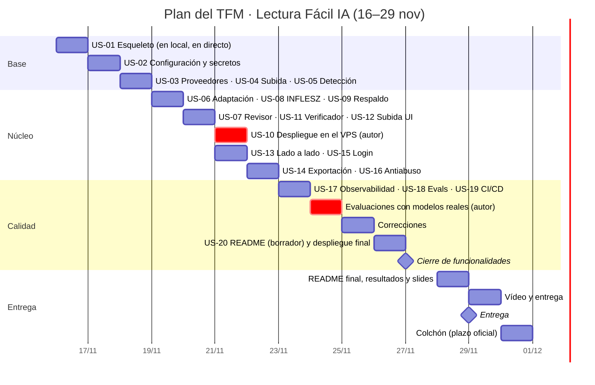

### Plan día a día

"Agentes" indica las historias que se lanzan esa tarde para que los agentes las hagan en la nube **durante la jornada siguiente**.

| Día | El autor (tarde o día completo) | Agentes (al día siguiente) | Está hecho cuando… |
|---|---|---|---|
| **Dom 15** | Preparación (lista de arriba) | — | Textos reunidos, repositorio creado, Azure y Tailscale listos |
| **Lun 16** | **US-01 en local con el agente**, en directo (es la base) | US-02 | `docker compose up` levanta todo y CI en verde |
| **Mar 17** | Revisar US-02 | US-03, US-04, US-05 | La API no arranca si falta un secreto |
| **Mié 18** | Revisar las tres; probar US-03 con las claves reales | US-06, US-08, US-09 | Se sube un PDF y se ven sus problemas detectados |
| **Jue 19** | Revisar; probar la adaptación con el servidor propio | US-07, US-11, US-12 | El ejemplo de la sección 5 se adapta y, al parar llama-swap, responde Azure |
| **Vie 20** | Revisar | US-13, US-15 | El ejemplo del IPREM genera su aviso de *revisar cálculo* |
| **Sáb 21** (completo) | **US-10: despliegue en el VPS**; revisar US-13 y US-15 | US-14, US-16 | URL pública funcionando y flujo completo en el navegador |
| **Dom 22** (completo) | Revisar US-14 y US-16; pruebas de punta a punta | US-17, US-18, US-19 | Exportación en los cuatro formatos; login y límites activos |
| **Lun 23** | Revisar US-17, US-18 y US-19 | Correcciones | CI completo en verde; despliegue automático funcionando |
| **Mar 24** | **Ejecutar las evaluaciones** con los modelos reales | Correcciones | Tabla de resultados rellena |
| **Mié 25** | Revisar correcciones | US-20 (borrador) | Sin errores conocidos graves |
| **Jue 26** | Despliegue final y pruebas en la URL pública; revisar US-20 | — | La instancia pública funciona de principio a fin |
| **Vie 27** | **Cierre de funcionalidades** | — | Nada nuevo a partir de aquí |
| **Sáb 28** (completo) | README final, resultados de evaluación, slides | — | README con los 7 apartados obligatorios y slides terminadas |
| **Dom 29** (completo) | **Vídeo y entrega** | — | Formulario enviado |
| Lun 30 | *Colchón (plazo oficial)* | — | — |

> **Regla del plan:** si al final de un día no se cumple su *"está hecho cuando"*, **se recorta alcance** siguiendo el orden de arriba, no se alarga el plazo. Y alguna tarde sin pantalla también forma parte del plan.

---

## 22. Entregables del TFM

| Requisito | Cómo se cumple |
|---|---|
| README completo (descripción, stack, instalación, estructura, funcionalidades, usuario de prueba) | `README.md` del repositorio |
| Código en repositorio público de GitHub | `lectura-facil-ia` |
| Despliegue funcionando | URL de la aplicación desplegada |
| Slides con URL pública | Enlace en el README y copia en `docs/slides/` |
| Vídeo con captura de pantalla | Demo: de una convocatoria enrevesada a un documento en lectura fácil |
| Usuario y contraseña de prueba | En el README y en el formulario |

### Guion del vídeo (5–7 min)

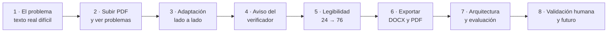

---

## 23. Riesgos

| Riesgo | Probabilidad | Impacto | Mitigación |
|---|---|---|---|
| La adaptación cambia el significado | Media | Alto | Verificador independiente + comprobación numérica + aviso visible |
| Pocos textos profesionales para evaluar | Media | Medio | Buscar desde el primer día; usar también textos trampa propios |
| El contador de sílabas falla con casos raros | Media | Bajo | Tests con palabras difíciles; marcar el índice como aproximado |
| Servidor IA o homelab caído durante la evaluación | Media | Medio | Respaldo automático a Azure (Data Zone EU); alertas a ntfy; suspensión nocturna desactivada |
| Cuota insuficiente en Azure para los despliegues | Baja | Medio | Crear el recurso el día de preparación; pedir aumento de cuota si sale a 0 |
| VPS comprometido | Baja | Alto | ACLs de Tailscale (solo el puerto de llama-swap), API key, proxy y firewall cerrado |
| Servidor propio no disponible | Baja | Medio | Con el respaldo configurado, la aplicación no depende de él |
| Falta de tiempo (solo tardes y fines de semana) | Alta | Alto | Agentes en la nube durante la jornada; orden de recortes definido; criterio de "hecho" diario; despliegue el 21; cierre de funcionalidades el 27; entrega el 29 y colchón hasta el 30 |
| Revisión insuficiente de lo que generan los agentes por cansancio | Media | Alto | Historias pequeñas, tests obligatorios, CI estricto y revisión automática de PR como apoyo; no fusionar nada sin probarlo |
| Percepción de que la IA "sustituye" la validación | Baja | Alto | Etiqueta de borrador y flujo de validación explícitos |

---

## 24. Módulos del máster que cubre

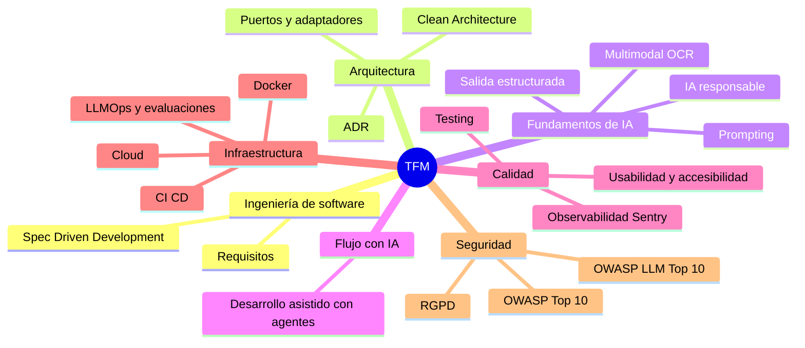

---

## 25. Evolución futura

- **OCR de PDFs escaneados** con Qwen3-VL-8B (recortado del MVP por plazo).
- **Validadores con cuenta propia y roles diferenciados** (técnica y validador). Hoy la validación la anota la misma
  persona que adaptó el documento (US-21), porque el grupo destinatario suele validar en una sesión con el texto
  impreso. Con roles, una persona validadora podría leer y anotar el resultado desde su cuenta, lo que exige compartir
  documentos entre usuarios y revisar la autorización por objeto.
- **Pictogramas ARASAAC** junto a las ideas clave (respetando su licencia).
- **Gestión de validación**: grupos de validadores, sesiones, comentarios por frase.
- **Extensión de navegador** para adaptar páginas web.
- **Plantillas por organización** (logo, colores) y exportación a ODT.
- **Glosarios compartidos** por organización.
- **Integración** con gestores documentales y portales de transparencia.
- **Colaboración** con entidades especializadas (por ejemplo, federaciones de Plena Inclusión).

---

## 26. Licencias

| Componente | Licencia / condiciones a revisar |
|---|---|
| Código del proyecto | **Apache 2.0**, con fichero `NOTICE`. Concesión explícita de patentes; el software se entrega "tal cual", sin garantías |
| PdfPig | Apache 2.0 |
| Open XML SDK | MIT |
| PDFsharp + MigraDoc | MIT |
| Fuente Atkinson Hyperlegible | SIL Open Font License |
| Modelos de IA | **Cada modelo tiene su licencia y condiciones de uso; las acepta quien lo configura.** En la instancia del TFM: Gemma (términos de Google), Qwen (Apache 2.0 según versión), Salamandra (Apache 2.0) y los de Azure (condiciones de Microsoft) |
| Pictogramas ARASAAC (v2) | CC BY-NC-SA: citar autor (Sergio Palao) y ARASAAC; **no comercial** sin permiso |
| Norma UNE 153101 EX | Documento con derechos de AENOR: se aplican sus pautas, no se reproduce el texto |

---

## 27. Glosario

| Término | Definición |
|---|---|
| **Lectura fácil** | Método de redacción y maquetación de textos accesibles para personas con dificultades de comprensión lectora |
| **UNE 153101 EX** | Norma española experimental con las pautas de lectura fácil |
| **Validación** | Revisión del texto por personas del grupo destinatario para confirmar que lo entienden |
| **INFLESZ** | Escala de legibilidad para el castellano basada en la fórmula de Szigriszt-Pazos |
| **LLM** | Modelo de lenguaje grande |
| **Verificador** | Modelo que comprueba que la adaptación conserva los datos clave del original |
| **Proveedor de respaldo** | Proveedor de IA que solo se usa si el principal no responde y está habilitado en la configuración |
| **ARASAAC** | Centro Aragonés para la Comunicación Aumentativa y Alternativa; biblioteca de pictogramas |
| **OCR** | Reconocimiento de texto en imágenes |

---

## 28. Referencias

- ATECA (Revista Siglo Cero, USAL): https://revistas.usal.es/tres/index.php/0210-1696/article/download/32147/30338/124450
- ALF-INICO (Gredos USAL): https://gredos.usal.es/handle/10366/166547
- Piloto de IA y lectura fácil del Gobierno de Aragón: https://www.aragon.es/w/inteligencia-artificial-y-lectura-f%C3%A1cil-un-piloto-hacia-una-informaci%C3%B3n-m%C3%A1s-clara-y-accesible-en-arag%C3%B3n
- Universidad de La Rioja y Plena Inclusión: https://nuevecuatrouno.com/2024/10/08/universidad-rioja-plena-inclusion-lectura-facil/
- ARASAAC: https://arasaac.org
- OWASP Top 10 for LLM Applications: https://genai.owasp.org
- Azure AI Foundry, disponibilidad de modelos por región: https://learn.microsoft.com/en-us/azure/foundry/foundry-models/concepts/models-sold-directly-by-azure-region-availability
- Azure OpenAI, precios: https://azure.microsoft.com/en-us/pricing/details/azure-openai/
- Tailscale, control de acceso (ACLs): https://tailscale.com/kb/1018/acls
- Cloudflare Tunnel: https://developers.cloudflare.com/cloudflare-one/connections/connect-networks/
