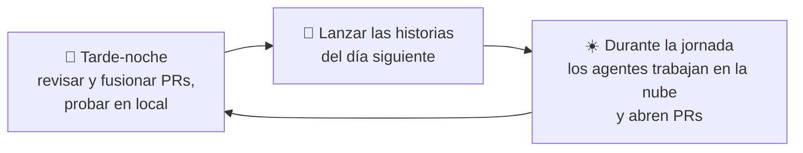
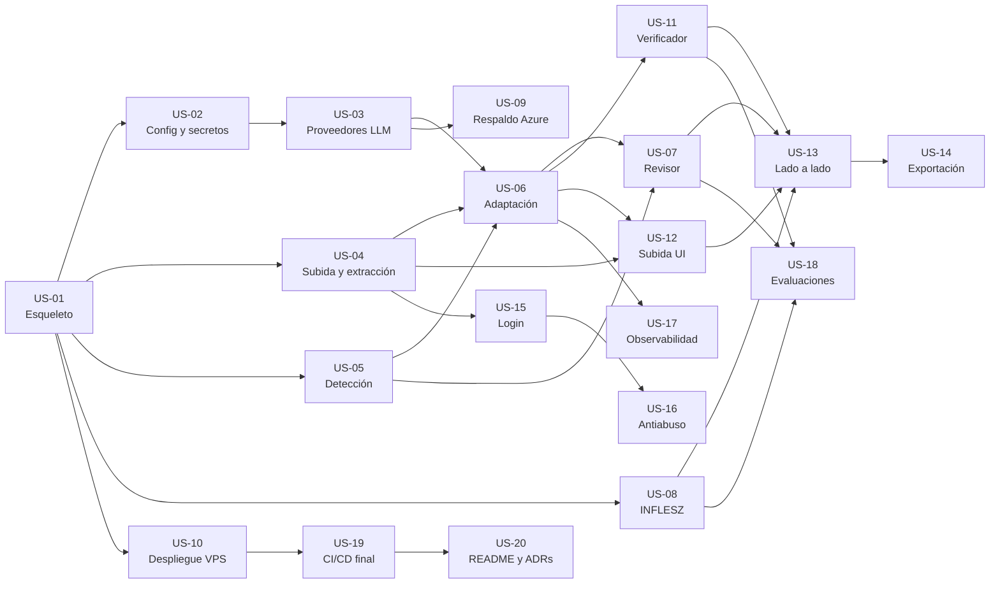

# Backlog del TFM · Lectura Fácil IA

Backlog en formato **Scrum** pensado para que lo ejecuten **agentes de programación** (Claude Code, Codex, OpenCode, Copilot agent…), con revisión humana en cada historia.

El producto es **open source y autoalojable**: se publica en GitHub y cualquiera puede instalarlo en su infraestructura con los proveedores de IA que elija. El despliegue del TFM (VPS + servidor IA propio + Azure de respaldo) es solo **una instancia de ejemplo**.

> Documento de diseño de referencia: [`../TFM-Lectura-Facil.md`](../TFM-Lectura-Facil.md)

---

## Contenido de esta carpeta

| Archivo | Para qué sirve |
|---|---|
| [`AGENTS.md`](../../AGENTS.md) | **Reglas para los agentes**: arquitectura, clean code, seguridad, tests y flujo de trabajo. Está en la **raíz del repositorio** |
| [`DEFINITION-OF-READY-DONE.md`](DEFINITION-OF-READY-DONE.md) | Cuándo una historia está lista para empezar y cuándo está terminada |
| [`PLANTILLA-US.md`](PLANTILLA-US.md) | Plantilla para nuevas historias |
| [`historias/`](historias/) | Las 20 historias de usuario |

---

## Cómo se usa con un agente

1. **Prepara el repositorio** (lo haces tú, una vez):
   - Crea el repositorio `lectura-facil-ia` en GitHub.
   - Copia `AGENTS.md` a la raíz.
   - Copia esta carpeta a `docs/backlog/` y `../TFM-Lectura-Facil.md` a `docs/TFM-Lectura-Facil.md`.
   - Para Claude Code, crea un `CLAUDE.md` en la raíz con una sola línea: `Lee y sigue AGENTS.md.`
   - Crea **una *issue* de GitHub por historia** con el contenido de su fichero (etiqueta `US-XX`).
2. **Lanza la historia** de una de estas dos formas:
   - **En local** (en directo): abre el agente en el repositorio y pega el **prompt de arranque** del final de la historia. Revisas su plan antes de que escriba código.
   - **En la nube** (mientras estás en el trabajo): asigna la *issue* a un agente en la nube (tareas en la nube de Codex, agente de Copilot, Claude Code en la web…). El agente **pone su plan en la descripción de la PR** y sigue sin esperar confirmación.
3. **Revisa la PR por la tarde**: plan y código a la vez. El agente trabaja en su rama `feat/US-XX-…` y nunca fusiona. Tú revisas (o pasas CodeRabbit), pruebas y fusionas.
4. **Marca la historia como hecha** en la tabla de abajo.

### Rutina diaria (tardes y fines de semana)

- Los agentes en la nube **no reciben secretos**: los tests usan `FakeLlmProvider`.
- Lo que necesita a una persona (infraestructura, despliegue, evaluaciones con modelos reales, slides, vídeo) va a las tardes y a los fines de semana.
- Todo desde **dispositivos y cuentas personales**.

### Historias en paralelo
Las historias que se lanzan el mismo día no dependen entre sí y pueden hacerse a la vez: en la nube, una *issue* por agente; en local, **un agente por worktree** (`git worktree add ../lf-US-05 -b feat/US-05-…`).

---

## Épicas

| Épica | Objetivo |
|---|---|
| **EP-01 Base** | Esqueleto, configuración segura y conexión con los modelos |
| **EP-02 Entrada** | Recibir textos y PDFs de forma segura y detectar problemas |
| **EP-03 Adaptación** | Generar la lectura fácil, revisar pautas, medir legibilidad y ser resiliente |
| **EP-04 Verificación** | Garantizar que no se pierde ni cambia ningún dato clave |
| **EP-05 Interfaz** | Experiencia de revisión lado a lado |
| **EP-06 Exportación** | Exportar en el formato que elija el usuario: DOCX, PDF, Markdown o texto |
| **EP-07 Seguridad y acceso** | Login, autorización y protección frente a abuso |
| **EP-08 Calidad y operación** | Observabilidad, evaluaciones y despliegue continuo |
| **EP-09 Documentación** | README, ADRs y material de entrega |

---

## Backlog priorizado

| ID | Historia | Épica | Prioridad | Puntos | Día | Depende de | Humano | Estado |
|---|---|---|---|---|---|---|---|---|
| [US-01](historias/US-01-esqueleto-solucion.md) | Esqueleto de la solución | EP-01 | Must | 5 | Lun 16 | — | No | 🔍 |
| [US-02](historias/US-02-configuracion-y-secretos.md) | Configuración y secretos validados | EP-01 | Must | 2 | Mar 17 | US-01 | No | 🔍 |
| [US-03](historias/US-03-proveedores-llm.md) | Proveedores LLM (local y Azure) | EP-01 | Must | 5 | Mié 18 | US-02 | Sí: endpoints y claves | 🔍 |
| [US-04](historias/US-04-subida-y-extraccion.md) | Subir texto o PDF y extraer el texto | EP-02 | Must | 3 | Mié 18 | US-01 | No | 🔍 |
| [US-05](historias/US-05-deteccion-de-problemas.md) | Detectar problemas del original | EP-02 | Must | 3 | Mié 18 | US-01 | No | 🔍 |
| [US-06](historias/US-06-adaptacion-con-llm.md) | Adaptar el texto con el LLM | EP-03 | Must | 5 | Jue 19 | US-03, US-04, US-05 | No | 🔍 |
| [US-07](historias/US-07-revisor-de-pautas.md) | Revisor de pautas | EP-03 | Must | 2 | Vie 20 | US-05, US-06 | No | 🔍 |
| [US-08](historias/US-08-indice-de-legibilidad.md) | Índice de legibilidad INFLESZ | EP-03 | Must | 3 | Jue 19 | US-01 | No | 🔍 |
| [US-09](historias/US-09-resiliencia-y-respaldo.md) | Proveedores configurables con respaldo opcional | EP-03 | Must | 3 | Jue 19 | US-03 | No | 🔍 |
| [US-10](historias/US-10-despliegue-esqueleto-vps.md) | Despliegue del esqueleto en el VPS | EP-08 | Must | 3 | Sáb 21 | US-01 | **Sí: infraestructura** | ⬜ |
| [US-11](historias/US-11-verificador-del-significado.md) | Verificador del significado | EP-04 | Must | 5 | Vie 20 | US-06 | No | 🔍 |
| [US-12](historias/US-12-subida-y-progreso-ui.md) | Pantalla de subida y progreso | EP-05 | Must | 3 | Vie 20 | US-04, US-06 | No | 🔍 |
| [US-13](historias/US-13-vista-lado-a-lado.md) | Vista lado a lado con edición | EP-05 | Must | 5 | Sáb 21 | US-07, US-08, US-11, US-12 | No | 🔍 |
| [US-14](historias/US-14-exportacion.md) | Exportar en DOCX, PDF, Markdown o texto | EP-06 | Must | 5 | Dom 22 | US-13 | No | 🔍 |
| [US-15](historias/US-15-login-y-autorizacion.md) | Login y autorización por documento | EP-07 | Must | 3 | Sáb 21 | US-04 | No | 🔍 |
| [US-16](historias/US-16-antiabuso.md) | Protección frente a abuso: Turnstile y límites | EP-07 | Must | 2 | Dom 22 | US-15 | Sí: claves de Turnstile | ⬜ |
| [US-17](historias/US-17-observabilidad.md) | Observabilidad sin datos personales | EP-08 | Should | 2 | Lun 23 | US-06 | Sí: DSN de Sentry | 🔍 |
| [US-18](historias/US-18-evaluaciones.md) | Evaluaciones de modelos | EP-08 | Must | 5 | Lun 23 | US-07, US-08, US-11 | Sí: textos de referencia | 🔍 |
| [US-19](historias/US-19-cicd-y-despliegue-final.md) | CI/CD y despliegue final | EP-08 | Must | 3 | Lun 23 | US-10 | Sí: secretos de GitHub | ⬜ |
| [US-20](historias/US-20-readme-y-adrs.md) | README, licencia y documentación open source | EP-09 | Must | 3 | Jue 26 | Todas | Sí: URLs de slides y vídeo | ⬜ |

**Total:** 70 puntos. El **Día** es cuándo trabaja el agente (en la nube durante la jornada, o en local esa tarde). **Cierre de funcionalidades:** viernes 27. **Entrega:** domingo 29. **Plazo oficial:** lunes 30.

> Slides, vídeo y formulario de entrega (28–29 nov) son tareas **humanas** y no están en este backlog. El plan completo día a día está en la sección 21 de `TFM-Lectura-Facil.md`.

**Si no da tiempo, se recorta en este orden:** US-17 (observabilidad) → exportación a PDF dentro de la US-14 → US-19 (se despliega a mano) → evaluación con 2 modelos.

---

## Dependencias

---

## Reglas del sprint

- **Un día = un objetivo.** Si a final del día no se cumple, se recorta alcance (en el orden de arriba), no se alarga el plazo.
- **Nada se fusiona sin probarlo**, aunque los tests estén en verde y sea tarde.
- **Ninguna historia se cierra** sin cumplir la [Definition of Done](DEFINITION-OF-READY-DONE.md).
- **El agente nunca fusiona ni hace push a `main`.** La última palabra es siempre humana.
- **Seguridad desde la primera historia** (*shift left*): no se deja "para el final".
