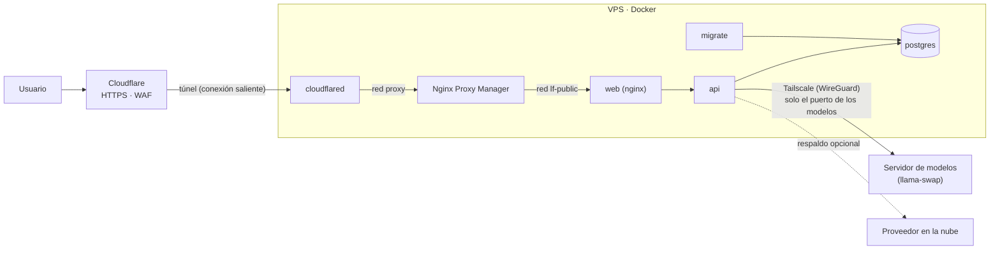
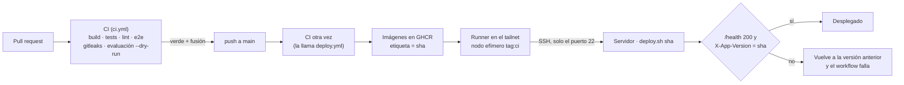

# Despliegue

Lectura Fácil IA es autoalojable: cada organización la despliega en su infraestructura y con los proveedores de IA que
elija. Esta guía tiene dos opciones:

| Opción | Para quién | Qué necesita |
|---|---|---|
| [**Mínima**](#opción-mínima) | Probarla o usarla en una red interna | Un servidor con Docker y un proveedor compatible con OpenAI |
| [**Servidor público**](#servidor-público-detrás-de-un-proxy-inverso) | Publicarla en internet | Además, un proxy inverso con HTTPS (aquí, el ejemplo de la instancia del TFM) |

Las dos usan los mismos ficheros de [`deploy/`](../deploy): `docker-compose.yml` (base) y, en un servidor público,
`docker-compose.prod.yml` encima. Nada de la infraestructura del ejemplo (VPS, Tailscale, Cloudflare, Nginx Proxy
Manager) está en el código: se puede cambiar cualquier pieza por otra equivalente.

## Qué se despliega

| Servicio | Imagen | Qué hace |
|---|---|---|
| `postgres` | `postgres:18.4-alpine` | Base de datos, en el volumen `postgres-data`. Nunca publica su puerto. |
| `migrate` | la de la API | Aplica las migraciones con el rol propietario y termina. |
| `api` | `src/LecturaFacil.Api/Dockerfile` | API .NET y la cola de adaptación. Imagen sin shell, usuario no root. |
| `web` | `src/LecturaFacil.Web/Dockerfile` | nginx sin root: sirve Angular y reenvía `/api` y `/health` a la API. |

Todos corren sin root, con `no-new-privileges`; la API y la web, además, con el sistema de ficheros de solo lectura y
sin capacidades (`cap_drop: ALL`).

**Base de datos con mínimo privilegio.** Al crear el volumen, [`10-roles.sh`](../deploy/postgres/initdb/10-roles.sh)
crea tres roles, cada uno con su contraseña:

| Rol | Variable | Para qué |
|---|---|---|
| Superusuario | `POSTGRES_USER` | Solo inicializa la base y hace los backups. |
| Propietario | `POSTGRES_OWNER_USER` | Lo usa `migrate` para crear y cambiar tablas. No es superusuario. |
| Aplicación | `POSTGRES_APP_USER` | El de la API: solo `SELECT`, `INSERT`, `UPDATE` y `DELETE`. |

Si alguien consiguiera ejecutar SQL a través de la API, no podría borrar tablas, cambiar el esquema ni leer otras bases.

---

## Opción mínima

En cualquier máquina con Docker y Docker Compose:

```bash
git clone https://github.com/DavidMartinCasas/lectura-facil-ia.git
cd lectura-facil-ia
cp deploy/.env.example deploy/.env
# Edita deploy/.env: las tres contraseñas de PostgreSQL y LLM__PRIMARY__* (README, "Proveedores de IA").
docker compose -f deploy/docker-compose.yml up -d --build
curl http://localhost:8080/health   # {"status":"Healthy"}
```

La web queda en `http://localhost:8080`, solo en `127.0.0.1` (cambia el puerto con `WEB_PORT`). Para que otras
personas entren, ponla detrás de un proxy con HTTPS, como en la opción siguiente: la cookie de sesión exige HTTPS salvo
en `localhost`.

---

## Servidor público detrás de un proxy inverso

### Arquitectura del ejemplo

Es la instancia del TFM: un VPS en la UE con Docker, sin ningún puerto abierto a internet. La entrada llega por un
túnel de Cloudflare y un proxy inverso (Nginx Proxy Manager) que ya sirve otras aplicaciones; los modelos están en un
servidor propio al que el VPS llega por Tailscale.



- **Ningún puerto publicado:** `docker-compose.prod.yml` quita el de la web. Solo el proxy la alcanza, por la red
  `lf-public`, que comparte con ella y con nada más: la API y PostgreSQL siguen en sus redes internas.
- **Una red solo para esta aplicación.** Si el proxy tiene otros servicios en su red (por ejemplo, un panel de
  administración), la web no los ve.
- **Cloudflare descifra el tráfico.** Termina el TLS, así que ve los textos que se suben. Para una demostración con
  documentos de prueba es aceptable; si vas a tratar datos personales, valora un proxy con TLS propio (por ejemplo,
  Caddy con Let's Encrypt) y revisa el encargo de tratamiento.

Puedes cambiar cualquier pieza: Caddy o Traefik en lugar de Nginx Proxy Manager, el puerto 443 abierto en lugar del
túnel, o una red privada en lugar de Tailscale. Lo que hace falta es que el proxy llegue a la web por `lf-public`, en
`http://lectura-facil-web:8080`.

### 1. Preparar el servidor

En un VPS recién instalado (los comandos son de Debian; adáptalos a tu distribución):

1. **Usuario sin root con sudo** y tu clave pública SSH en `~/.ssh/authorized_keys`.
2. **SSH solo con clave**, en `/etc/ssh/sshd_config.d/00-hardening.conf`:
   ```text
   PermitRootLogin no
   PasswordAuthentication no
   KbdInteractiveAuthentication no
   AuthenticationMethods publickey
   ```
   `sudo sshd -t && sudo systemctl reload ssh`, y comprueba que entras **en otra sesión** antes de cerrar la actual.
3. **Actualizaciones automáticas:** `sudo apt install unattended-upgrades && sudo dpkg-reconfigure unattended-upgrades`.
4. **Docker** desde su repositorio oficial ([docs.docker.com/engine/install/debian](https://docs.docker.com/engine/install/debian/)).
   Limita los logs en `/etc/docker/daemon.json`:
   ```json
   { "log-driver": "json-file", "log-opts": { "max-size": "10m", "max-file": "3" } }
   ```
5. **Tailscale** en el host ([tailscale.com/download/linux](https://tailscale.com/download/linux)), con una clave de un
   solo uso y una etiqueta propia, sin aceptar rutas ni usar exit node:
   ```bash
   sudo tailscale up --auth-key=<clave-de-un-solo-uso> --advertise-tags=tag:lf-web --accept-routes=false
   ```
6. **Firewall que bloquea toda la entrada** salvo Tailscale. SSH solo por la interfaz de Tailscale:
   ```bash
   sudo apt install ufw
   sudo ufw default deny incoming && sudo ufw default allow outgoing
   sudo ufw allow in on tailscale0 to any port 22 proto tcp
   sudo ufw allow 41641/udp          # conexiones directas de Tailscale
   sudo ufw enable
   ```
   Comprueba que entras por SSH a la IP de Tailscale **antes** de quitar el acceso público. Si tu proveedor tiene un
   firewall de red (como el Edge Network Firewall de OVHcloud), deniega en él todo lo entrante salvo lo que necesiten
   Tailscale y las respuestas.

### 2. Tailscale: el servidor solo llega a los modelos

La política del tailnet no debe tener la regla `* → *`. Con etiquetas, el VPS (`tag:lf-web`) solo llega al puerto del
servidor de modelos (`tag:ia`), y a él solo llegan tus dispositivos. Ejemplo en la política de acceso
([login.tailscale.com/admin/acls](https://login.tailscale.com/admin/acls)):

```jsonc
{
  "tagOwners": {
    "tag:lf-web": ["autogroup:admin"],
    "tag:ia": ["autogroup:admin"]
  },
  "grants": [
    // Tus dispositivos administran el VPS (añade los puertos de tus paneles, si los usas por Tailscale).
    { "src": ["autogroup:member"], "dst": ["tag:lf-web"], "ip": ["tcp:22"] },
    // El VPS solo puede llamar a los modelos.
    { "src": ["tag:lf-web"], "dst": ["tag:ia"], "ip": ["tcp:<puerto-de-los-modelos>"] }
  ],
  "tests": [
    {
      "src": "tag:lf-web",
      "accept": ["tag:ia:<puerto-de-los-modelos>"],
      "deny": ["tag:ia:22", "<ip-tailscale-de-otro-equipo>:22"]
    }
  ]
}
```

Antes de quitar `* → *`, añade las reglas que ya usen tus otros equipos, o perderás accesos. La sección `tests` hace que
Tailscale rechace cualquier cambio de la política que deje al VPS llegar donde no debe.

En el servidor de modelos, protege la API con una clave y, si puedes, deja pasar solo las rutas de inferencia
(`/v1/chat/completions`). En `deploy/.env`, el endpoint es su IP de Tailscale:
`LLM__PRIMARY__ENDPOINT=http://<ip-tailscale-de-los-modelos>:<puerto>/v1`. Va por http, pero cifrado por la VPN
(la API admite http hacia `100.64.0.0/10`, la red de Tailscale).

### 3. Proxy inverso y túnel

Si ya tienes un proxy y un túnel para otras aplicaciones, solo hay que darles acceso a la web.

1. **La red compartida:**
   ```bash
   docker network create lf-public
   ```
2. **Conecta el proxy a ella.** En el `compose.yaml` de Nginx Proxy Manager, añade `lf-public` junto a las redes que
   ya tenga, y `docker compose up -d`:
   ```yaml
   services:
     nginx-proxy-manager:
       networks:
         - proxy        # la que ya usa con cloudflared
         - lf-public
   networks:
     proxy:
       external: true
     lf-public:
       external: true
   ```
3. **Si aún no tienes túnel:** crea uno en Cloudflare Zero Trust (*Networks → Tunnels*), guarda su token en un `.env`
   con permisos `600` y levanta `cloudflared` en la misma red que el proxy, con una versión fijada (no `latest`):
   ```yaml
   services:
     cloudflared:
       image: cloudflare/cloudflared:<versión>
       command: tunnel --no-autoupdate run
       environment:
         TUNNEL_TOKEN: ${TUNNEL_TOKEN}
       networks:
         - proxy
       read_only: true
       cap_drop: [ALL]
       security_opt: [no-new-privileges:true]
       restart: unless-stopped
   networks:
     proxy:
       external: true
   ```

La configuración del proxy y del túnel para el subdominio se hace al final, en el paso 5, cuando la aplicación ya
responde.

### 4. Desplegar la aplicación

```bash
sudo mkdir -p /opt/docker/apps && sudo chown "$USER" /opt/docker/apps
cd /opt/docker/apps
git clone https://github.com/DavidMartinCasas/lectura-facil-ia.git lectura-facil
cd lectura-facil
umask 077
cp deploy/.env.prod.example deploy/.env
chmod 600 deploy/.env
nano deploy/.env
```

En `deploy/.env` cambia como mínimo:

- `POSTGRES_PASSWORD`, `POSTGRES_OWNER_PASSWORD` y `POSTGRES_APP_PASSWORD`: tres contraseñas distintas
  (`openssl rand -base64 32`). Se fijan al crear el volumen; cambiarlas después aquí no cambia las de la base.
- `LLM__PRIMARY__*`: el servidor de modelos (paso 2) y los dos modelos.
- Para una demo pública, descomenta los límites que trae el fichero (textos más cortos y menos llamadas por persona).

Construye y arranca (en un VPS de 4 vCPU, la primera construcción tarda varios minutos):

```bash
docker compose -f deploy/docker-compose.yml -f deploy/docker-compose.prod.yml up -d --build
docker compose -f deploy/docker-compose.yml -f deploy/docker-compose.prod.yml ps
```

`migrate` debe aparecer como `exited (0)` y el resto como `healthy` o `running`. Si `migrate` falla, la API no arranca:
mira `docker compose -f deploy/docker-compose.yml logs migrate`.

Para no repetir los `-f`, puedes definir en tu shell
`export COMPOSE_FILE=deploy/docker-compose.yml:deploy/docker-compose.prod.yml` desde la raíz del repositorio.

### 5. Publicar el subdominio

1. **Nginx Proxy Manager** → *Proxy Hosts* → *Add*:
   - *Domain*: `<subdominio>` (por ejemplo, `lectura-facil.<tu-dominio>`).
   - *Scheme* `http`, *Forward Hostname* `lectura-facil-web`, *Port* `8080`.
   - *SSL*: ninguno y *Force SSL* desactivado: el HTTPS lo pone Cloudflare.
   - No hace falta configuración avanzada: la API envía `X-Accel-Buffering: no` (el nginx de la web la deja pasar
     hasta el proxy) para que el progreso (SSE) no se quede en el búfer, y un `ping` cada 30 s para que no se corte la
     conexión. Si tu proxy no es nginx y no entiende esa cabecera, desactiva su búfer para
     `/api/documents/*/events`.
2. **Cloudflare Zero Trust** → el túnel → *Published application routes* → *Add*:
   - `<subdominio>` → `http://nginx-proxy-manager:80`, sin cambiar la cabecera `Host`.
   - No uses rutas comodín (`*.dominio`): publica solo este subdominio.
3. Opcional: en Cloudflare, una regla de límite de peticiones para `/api/` y, si activas Turnstile
   (`TURNSTILE__*`), el widget con el subdominio.

### 6. Comprobaciones

Desde fuera del servidor:

```bash
curl -s https://<subdominio>/health                       # {"status":"Healthy"}
curl -sI https://<subdominio>/ | grep -i content-security-policy
curl -s -o /dev/null -w "%{http_code}\n" https://<subdominio>/metrics   # 404: las métricas no se publican
```

Después, en el navegador: inicia sesión, adapta un documento corto y comprueba que el progreso avanza paso a paso.

**Pruebas negativas** (anota los resultados en el PR del despliegue):

| Desde | Prueba | Resultado esperado |
|---|---|---|
| Internet | `nc -vz -w 5 <ip-pública-del-vps> 22`, `80`, `443`, `8080` | Todos fallan |
| Internet | `nmap -Pn --top-ports 100 <ip-pública-del-vps>` | Ningún puerto abierto |
| VPS | `curl -s -o /dev/null -w "%{http_code}" http://<ip-tailscale-de-los-modelos>:<puerto>/v1/models -H "Authorization: Bearer <clave>"` | `200` |
| VPS | `nc -vz -w 5 <ip-tailscale-de-los-modelos> 22` | Falla |
| VPS | `nc -vz -w 5 <ip-tailscale-de-otro-equipo> 22` (y otros puertos de tu red) | Falla |
| VPS | `docker compose -f deploy/docker-compose.yml exec -T postgres psql -U <POSTGRES_USER> -d <POSTGRES_DB> -tAc "select rolsuper from pg_roles where rolname = '<POSTGRES_APP_USER>'"` | `f` |
| VPS | `docker compose -f deploy/docker-compose.yml exec -T web wget -qO- -T 5 http://postgres:5432` | Falla: la web no ve la base |

### 7. Copias de seguridad

[`deploy/scripts/backup-postgres.sh`](../deploy/scripts/backup-postgres.sh) hace un `pg_dump` comprimido en
`/var/backups/lectura-facil` (cámbialo con `BACKUP_DIR`) y borra los de más de 7 días (`BACKUP_RETENTION_DAYS`). Las
copias solo las puede leer su dueño. Pruébalo a mano:

```bash
sudo /opt/docker/apps/lectura-facil/deploy/scripts/backup-postgres.sh
```

Prográmalo una vez al día con systemd:

```ini
# /etc/systemd/system/lectura-facil-backup.service
[Unit]
Description=Copia de seguridad de PostgreSQL de Lectura Fácil
Requires=docker.service
After=docker.service

[Service]
Type=oneshot
ExecStart=/opt/docker/apps/lectura-facil/deploy/scripts/backup-postgres.sh
```

```ini
# /etc/systemd/system/lectura-facil-backup.timer
[Unit]
Description=Copia diaria de Lectura Fácil

[Timer]
OnCalendar=*-*-* 03:30
Persistent=true

[Install]
WantedBy=timers.target
```

```bash
sudo systemctl daemon-reload && sudo systemctl enable --now lectura-facil-backup.timer
systemctl list-timers lectura-facil-backup.timer
```

Las copias están en el mismo servidor: llévalas también fuera (por ejemplo, con Proxmox Backup Server o `restic` por
Tailscale).

#### Restaurar una copia

En un volumen vacío, la restauración se hace **antes** de que `migrate` cree las tablas:

```bash
dc="docker compose -f deploy/docker-compose.yml -f deploy/docker-compose.prod.yml"
$dc down                                   # añade -v solo si quieres borrar el volumen actual
$dc up -d postgres                         # crea la base y los roles
$dc exec -T postgres sh -c 'pg_restore --username "$POSTGRES_USER" --dbname "$POSTGRES_DB" \
  --role="$POSTGRES_OWNER_USER" --no-owner --no-acl' < /var/backups/lectura-facil/lectura-facil-<fecha>.dump
$dc up -d                                  # migrate aplica solo lo que falte
```

Con `--role` y `--no-owner`, las tablas restauradas quedan a nombre del propietario y la API recibe sus permisos.
`pg_restore` termina con un error esperado, `must be owner of extension unaccent` (no puede cambiar el comentario de
la extensión, que creó la inicialización), y `errors ignored on restore: 1`: el resto se restaura igual.

### 8. Actualizar y volver atrás

```bash
cd /opt/docker/apps/lectura-facil
/opt/docker/apps/lectura-facil/deploy/scripts/backup-postgres.sh   # copia antes de actualizar
git pull
docker compose -f deploy/docker-compose.yml -f deploy/docker-compose.prod.yml up -d --build
```

Para poder volver atrás, construye cada versión con su etiqueta (`IMAGE_TAG=<versión>` en `deploy/.env`). Si algo falla,
vuelve a la etiqueta anterior y `up -d` sin `--build`. Una migración ya aplicada no se deshace sola: restaura la copia.

Con el despliegue automático (paso 9) no se construye nada en el servidor: `deploy.sh` hace todo esto solo.

### 9. Despliegue automático (CI/CD)

Con esto configurado, cada PR fusionada en `main` se despliega sola: la CI completa, las imágenes en GitHub Container
Registry (GHCR) con la etiqueta del commit y el despliegue en el servidor, que vuelve a la versión anterior si la nueva
no arranca. Sin configurarlo, el workflow solo publica las imágenes y el despliegue sigue siendo manual (paso 8).



| Pieza | Fichero | Qué hace |
|---|---|---|
| CI | [`.github/workflows/ci.yml`](../.github/workflows/ci.yml) | En cada PR y rama: build sin avisos, `dotnet format`, tests con cobertura (artefacto y resumen del job), paquetes vulnerables, lint, tests, e2e y build del front, `npm audit`, gitleaks, hadolint, shellcheck, actionlint, validación de compose, prueba de humo, roles de PostgreSQL, prueba de `deploy.sh` y evaluación `--dry-run`. |
| Despliegue | [`.github/workflows/deploy.yml`](../.github/workflows/deploy.yml) | Solo en push a `main` (nunca en PRs ni con código de forks), uno cada vez: CI → publicar → desplegar. Permisos mínimos por job: `packages: write` solo al publicar. |
| Script del servidor | [`deploy/scripts/deploy.sh`](../deploy/scripts/deploy.sh) | Copia de la base, ficheros de `deploy/` en el commit, `pull`, `up -d` (`migrate` antes que la API), espera a `/health` con la versión y, si falla, vuelve a la anterior. |
| Dependencias | [`.github/dependabot.yml`](../.github/dependabot.yml) | PR semanales para NuGet, npm, imágenes Docker y acciones (que siguen fijadas por SHA). |

Las imágenes son `ghcr.io/<propietario>/lectura-facil-api:<sha>` y `ghcr.io/<propietario>/lectura-facil-web:<sha>`,
con `<propietario>` en minúsculas. No hay etiqueta `latest`: cada despliegue nombra exactamente qué versión corre.

#### 9.1 Usuario de despliegue en el servidor

Un usuario propio cuya clave SSH **solo puede ejecutar `deploy.sh`**. Como lanza `docker`, el grupo `docker` le da en la
práctica permisos de root: por eso su clave no admite nada más que el script.

```bash
sudo adduser --disabled-password --gecos "" lf-deploy
sudo usermod -aG docker lf-deploy
sudo chown -R lf-deploy: /opt/docker/apps/lectura-facil     # el repositorio y deploy/.env pasan a ser suyos
sudo install -d -o lf-deploy -g lf-deploy -m 700 /var/backups/lectura-facil
```

Pon `User=lf-deploy` en el servicio de copias del paso 7, para que el temporizador y el despliegue escriban en la misma
carpeta. A partir de aquí, los comandos manuales en el repositorio se lanzan como ese usuario (`sudo -u lf-deploy …`).

En tu equipo, una clave solo para la CI (sin frase de paso: la guarda GitHub):

```bash
ssh-keygen -t ed25519 -N "" -C "github-actions lectura-facil" -f lf-deploy-ci
```

En el servidor, su parte pública en `/home/lf-deploy/.ssh/authorized_keys` (directorio `700`, fichero `600`), en una
sola línea:

```text
restrict,from="100.64.0.0/10,fd7a:115c:a1e0::/48",command="/opt/docker/apps/lectura-facil/deploy/scripts/deploy.sh" ssh-ed25519 AAAA… github-actions lectura-facil
```

- `command=` ejecuta siempre el script, pida lo que pida el cliente. El script solo acepta un SHA de 40 caracteres
  hexadecimales (le llega en `SSH_ORIGINAL_COMMAND`); cualquier otra cosa la rechaza sin tocar nada.
- `restrict` quita la terminal, los reenvíos de puertos y de agente y X11.
- `from=` solo acepta la clave desde las direcciones de Tailscale (`100.64.0.0/10` y, en IPv6, `fd7a:115c:a1e0::/48`).
- El script solo despliega commits que estén en `main`: un SHA de otra rama o desconocido lo rechaza antes de tocar
  nada, aunque llegue con la clave de la CI.
- **No actives Tailscale SSH en este servidor** (`tailscale set --ssh=false`) ni metas `tag:ci` en la sección `ssh` de
  la política: Tailscale SSH atiende el puerto 22 del tailnet sin pasar por `authorized_keys`, y `command=`, `restrict`
  y `from=` dejarían de aplicarse.

Como el script pone `deploy/` en el commit desplegado, el repositorio queda en `HEAD` separado (*detached*); es normal.
El último SHA desplegado se guarda en `deploy/.release` (no se versiona) y es al que se vuelve si el siguiente falla.

**`deploy/.env` en el servidor:**

- `IMAGE_REGISTRY=ghcr.io/<propietario-en-minúsculas>/` (con la barra final). Así `docker compose` descarga las
  imágenes publicadas en lugar de construirlas.
- `OBSERVABILITY__RELEASE` vacía: la versión es la etiqueta de la imagen. Si tiene un valor, `deploy.sh` se niega a
  desplegar, porque `/health` nunca devolvería el SHA.
- `IMAGE_TAG` lo pone `deploy.sh` en cada despliegue; el de `deploy/.env` solo cuenta en los comandos manuales. Para
  usarlos con la versión desplegada: `export IMAGE_TAG=$(cat deploy/.release)`.

**Si los paquetes de GHCR son privados**, el usuario de despliegue tiene que iniciar sesión una vez. Lo más sencillo, al
ser un proyecto abierto, es hacerlos públicos (*Package settings → Change visibility*). Si no, crea un token clásico
solo con el permiso `read:packages` y, en el servidor:

```bash
sudo -u lf-deploy docker login ghcr.io -u <tu-usuario-de-github>   # pega el token cuando lo pida
```

Docker guarda el token en `/home/lf-deploy/.docker/config.json`, sin cifrar: ponle caducidad y nada más que ese permiso.

**Primer despliegue, a mano y obligatorio.** Antes de activar `DEPLOY_ENABLED` (9.3), despliega una vez a mano un
commit de `main` cuyas imágenes ya estén en GHCR (el workflow las publica aunque no despliegue). Así se crea
`deploy/.release` y el primer despliegue automático tiene una versión a la que volver si falla:

```bash
sudo -u lf-deploy /opt/docker/apps/lectura-facil/deploy/scripts/deploy.sh <sha-de-un-commit-de-main>
```

#### 9.2 Tailscale: la CI solo llega al SSH del servidor

El runner de GitHub entra en el tailnet como un **nodo efímero** con la etiqueta `tag:ci`, que desaparece al acabar el
job. Necesita:

1. **Un cliente OAuth** en la consola de Tailscale (*Settings → Trust credentials → OAuth client*) con el permiso
   `auth_keys` de escritura y la etiqueta `tag:ci`. Su ID y su secreto van a GitHub (9.3).
2. **La regla de acceso** `tag:ci → tag:lf-web:22`, y nada más. Junto a lo del paso 2:

```jsonc
{
  "tagOwners": {
    "tag:ci": ["autogroup:admin"]
    // … tag:lf-web y tag:ia, como en el paso 2
  },
  "grants": [
    // … las reglas del paso 2
    // La CI solo puede abrir SSH en el servidor de la aplicación.
    { "src": ["tag:ci"], "dst": ["tag:lf-web"], "ip": ["tcp:22"] }
  ],
  "tests": [
    {
      "src": "tag:ci",
      "accept": ["tag:lf-web:22"],
      "deny": ["tag:lf-web:8080", "tag:ia:22", "tag:ia:<puerto-de-los-modelos>"]
    }
  ]
}
```

El firewall del servidor ya deja entrar el 22 por `tailscale0` (paso 1). Con esta regla, un nodo `tag:ci` no llega ni a
los modelos ni a tus equipos, aunque alguien consiguiera ejecutar código en el runner.

Alternativa sin secreto guardado: la [federación de identidad](https://tailscale.com/kb/1581/workload-identity-federation)
de Tailscale con el OIDC de GitHub. En `deploy.yml`, cambia `oauth-secret` por `audience` y da al job
`id-token: write`.

#### 9.3 GitHub: environment, secretos y variables

En *Settings → Environments*, crea `production` y, en *Deployment branches and tags*, deja **solo `main`**. Si quieres
aprobar cada despliegue a mano, añade *Required reviewers*.

| Dónde | Nombre | Tipo | Valor |
|---|---|---|---|
| Environment `production` | `TS_OAUTH_CLIENT_ID` | Secreto | ID del cliente OAuth de Tailscale (9.2). |
| Environment `production` | `TS_OAUTH_SECRET` | Secreto | Su secreto. |
| Environment `production` | `DEPLOY_SSH_KEY` | Secreto | La clave privada `lf-deploy-ci` (el fichero entero). |
| Environment `production` | `DEPLOY_SSH_KNOWN_HOSTS` | Secreto | La línea de `known_hosts` del servidor (abajo). Sin ella no se conecta. |
| Environment `production` | `DEPLOY_HOST` | Variable | Nombre MagicDNS o IP de Tailscale del servidor. |
| Environment `production` | `DEPLOY_USER` | Variable | `lf-deploy`. |
| Environment `production` | `PUBLIC_URL` | Variable (opcional) | `https://<subdominio>`: el workflow comprueba también desde internet que `/health` da la versión nueva. Es informativa: si falla, el job sale en rojo pero no vuelve atrás. |
| Repositorio (*Actions → Variables*) | `DEPLOY_ENABLED` | Variable | `true`. Sin ella el workflow solo publica las imágenes (los forks no despliegan). |

La línea de `known_hosts`, desde un equipo del tailnet, comparando la huella con la del servidor:

```bash
ssh-keyscan -t ed25519 <host-tailscale> 2>/dev/null > known_hosts.lf
ssh-keygen -lf known_hosts.lf                                                   # en tu equipo
ssh <admin>@<host-tailscale> ssh-keygen -lf /etc/ssh/ssh_host_ed25519_key.pub   # debe coincidir
```

Con la CLI de GitHub (los secretos se leen de un fichero o se piden: no quedan en el historial de la shell):

```bash
gh secret set TS_OAUTH_CLIENT_ID --env production
gh secret set TS_OAUTH_SECRET --env production
gh secret set DEPLOY_SSH_KEY --env production < lf-deploy-ci
gh secret set DEPLOY_SSH_KNOWN_HOSTS --env production < known_hosts.lf
gh variable set DEPLOY_HOST --env production --body "<host-tailscale>"
gh variable set DEPLOY_USER --env production --body lf-deploy
gh variable set PUBLIC_URL --env production --body "https://<subdominio>"
gh variable set DEPLOY_ENABLED --body true   # después del primer despliegue a mano (9.1)
```

Después, borra `lf-deploy-ci` de tu equipo: si hace falta otra, se genera de nuevo.

En *Settings → Actions → General*, deja *Workflow permissions* en **Read repository contents**: cada job pide los permisos
que necesita.

#### 9.4 Protección de la rama `main`

En *Settings → Rules → Rulesets → New branch ruleset*, para la rama por defecto:

- **Require a pull request before merging.**
- **Require status checks to pass**, con los jobs de la CI: `Backend (.NET)`, `Frontend (Angular)`, `E2E (Playwright)`,
  `Evaluación (--dry-run)`, `Workflows (actionlint)`, `Secretos (gitleaks)` y `Contenedores`. Así, si algo falla, la PR
  no se puede fusionar.
- **Block force pushes** y **Restrict deletions**.

Como el despliegue solo sale de `main` y a `main` solo se llega por PR con la CI en verde, nada sin revisar llega al
servidor.

#### 9.5 Migraciones y vuelta atrás

`deploy.sh` vuelve a las imágenes anteriores, pero **no deshace las migraciones** que ya aplicó `migrate`. Para que la
vuelta atrás funcione, cada migración tiene que ser **compatible hacia atrás**: la versión anterior de la API debe
seguir funcionando con el esquema nuevo. En la práctica, en dos despliegues:

1. Añadir (columnas que admiten nulos o tienen valor por defecto, tablas nuevas) sin quitar nada que use la versión que
   corre.
2. Quitar lo que ya no se usa en un despliegue posterior, cuando la versión anterior ya no lo necesita.

Si una migración no puede ser compatible (renombrar o borrar una columna en uso), volver atrás exige **restaurar la
copia** que `deploy.sh` hace antes de cada despliegue (`/var/backups/lectura-facil`, paso 7), con lo que se pierde lo
escrito desde entonces. Indícalo en la PR de esa migración.

Para volver a mano a una versión concreta ya publicada: `sudo -u lf-deploy deploy/scripts/deploy.sh <sha>`.

#### 9.6 Probar el script sin servidor

[`tests/deploy/test-deploy.sh`](../tests/deploy/test-deploy.sh) monta un registro local que hace de GHCR y despliega el
compose real con la capa de producción, en un proyecto y una red aparte. Prueba el primer despliegue, una actualización
con copia de la base, una versión rota y una imagen que no existe (las dos vuelven a la anterior y fallan) y un SHA no
válido. Lo ejecuta la CI; en local:

```bash
cp deploy/.env.example deploy/.env          # si no lo tienes
docker compose -f deploy/docker-compose.yml build
tests/deploy/test-deploy.sh
```

### Problemas frecuentes

| Síntoma | Causa probable |
|---|---|
| Nginx Proxy Manager devuelve 502 | No está en la red `lf-public`, o el nombre no es `lectura-facil-web` (`WEB_HOSTNAME`). |
| `migrate` termina con error de autenticación | Las contraseñas de `deploy/.env` no son las del volumen: los roles se crean una sola vez. |
| La API no arranca y el log nombra una opción | Falta o no es válida en `deploy/.env` (el log dice cuál, nunca su valor). |
| El progreso no avanza hasta el final | El proxy guarda la respuesta en su búfer: comprueba que no reescribe `X-Accel-Buffering`. |
| No se puede llamar a los modelos | Prueba desde el VPS con `curl` (paso 6) y revisa las ACLs de Tailscale. |
| El job de despliegue no conecta por SSH | Si falla el `ping` de Tailscale, revisa el cliente OAuth y la regla `tag:ci → tag:lf-web:22`. Con `Host key verification failed`, `DEPLOY_SSH_KNOWN_HOSTS` no es la clave del servidor. |
| `deploy.sh` falla en `pull` con `denied` o `not found` | Los paquetes son privados y `lf-deploy` no ha hecho `docker login` (9.1), o `IMAGE_REGISTRY` no es `ghcr.io/<propietario-en-minúsculas>/`. |
| `deploy.sh` vuelve atrás porque `/health` no da la versión | `migrate` o la API no arrancan con la versión nueva: `docker compose logs migrate api`. Si `deploy/.env` tiene `OBSERVABILITY__RELEASE`, vacíala. |

### Instalaciones anteriores a los roles

Si tu volumen de PostgreSQL es anterior a esta versión, no tiene los roles propietario y aplicación (el script de init
solo se ejecuta con el volumen vacío). Haz una copia con la versión anterior del compose, crea el volumen de nuevo y
restaura la copia como en [Restaurar una copia](#restaurar-una-copia). En un entorno de pruebas sin datos que conservar,
basta con `docker compose -f deploy/docker-compose.yml down -v`.
